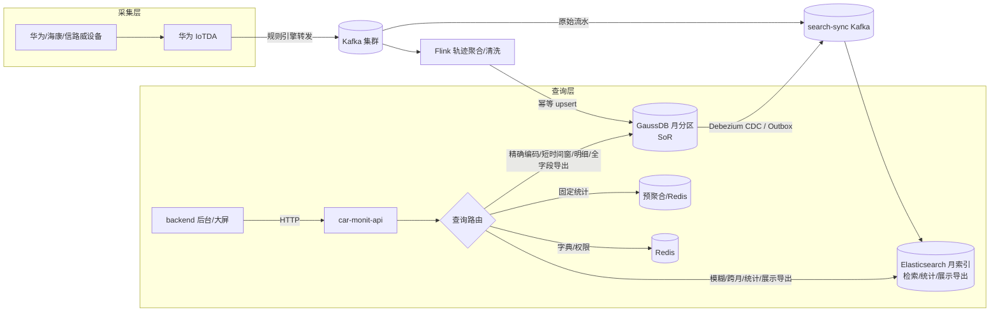

# 高速公路车辆监测系统 8 亿级流水查询：架构设计与技术选型方案

> 版本：v1.3（2026-11-08）  
> 范围：门架抓拍流水、收费流水、车辆历史轨迹三张核心表的查询、统计、导出与一致性设计  
> 定位：独立推导的架构决策文档。仓库内既有优化代码、README、SQL 仅作为**事实输入**（表结构、字段、查询语义、配置），不沿用其结论。  
> 变更：v1.1 按业务确认口径更新；v1.2 补充收费车牌真实格式、轨迹点实测、大屏统计改造；v1.3 新增 `jl_data01` 数据资产清单并重算容量。文中以 **【变更 v1.1/v1.2/v1.3】** 标注受影响位置。

## 变更记录

| 版本 | 日期 | 变更内容 |
|---|---|---|
| v1.0 | 2026-11-08 | 初版：独立推导候选架构、容量测算、关键决策、路线图与附录 |
| v1.1 | 2026-11-08 | ① 70 万/天确认为**单表**口径，重算三表 1/3 年容量、分区、ES 分片与成本；② 轨迹车牌统一为 `envehicleid`；③ 收费车牌增加颜色规范化与匹配设计；④ 导出改为“展示字段快速导出 + 全字段海量导出”双路径，取消字段/条数限制；⑤ 更新路线图、风险与待确认项 |
| v1.2 | 2026-11-08 | ① 收费车牌真实格式为 `赣B21E85_0`，下划线后为颜色枚举码，更新解析/校验/兜底与导出映射；② 实测 `trailpoints` 为 `text[]` JSON 字符串数组，平均 1,691.2B/行，修正轨迹存储与全字段导出估算；③ 补充大屏 11 个接口的现状瓶颈、预聚合/ES/缓存承接、前后延迟对比与灰度方案 |
| v1.3 | 2026-11-08 | ① 读取 `jl_data01` 全部 46 张表：完整表清单、行数估算、空间、列数、主键/索引、分区情况；② 识别核心/相关明细/维度/中间/系统表及重复 `carmonitdb` 表；③ 按真实核心表行宽重算 GaussDB 3 年 3.3TB、1 年 1.1TB，并修正全字段导出量；④ 指出未分区/缺时间索引/schema 漂移/空表/日志无界等模型问题 |

---

## 0. 结论先行

| 项目 | 结论 |
|---|---|
| 推荐架构 | **GaussDB 作为 System of Record + Elasticsearch 作为检索/统计/展示字段快速导出入口**（方案 B）；全字段海量导出走 GaussDB |
| 演进路径 | 阶段 2 在 GaussDB 内部增加列存/增量预聚合（方案 D）；MPP 仅在统计 QPS/并发/维度爆炸触发时引入（方案 C） |
| 明确否决 | 纯 GaussDB + pg_trgm/GIN 承担全模糊（方案 A）；ShardingSphere 分库分表；ES 作为主库（方案 E） |
| 核心取舍 | 维度名称码表化 + Redis 字典解析 + ES `term` 过滤；只有车牌使用 ngram；ES 不存 `trailpoints` 与 55 个 text 大字段 |
| 3 年容量量级 | **已确认三表各 70 万/天**。按 `jl_data01` 真实核心表行宽重算（抓拍 567.2B、收费 1,074.3B、轨迹 `trailpoints` 1,691.2B），GaussDB 合计约 **3.33TB**（抓拍 0.60TB / 收费 1.10TB / 轨迹 1.63TB，含索引与余量）；ES 合计约 3.0–4.0TB（含 1 副本与压缩）；1 年热数据约 GaussDB **1.11TB** + ES 1.0–1.3TB |
| 轨迹点 | `trailpoints` 为 `text[]` JSON 字符串数组，平均 16.7 点/行、1,691.2B/行；**ES 不存轨迹点**，只存摘要；详情/全字段导出回 GaussDB |
| 大屏 | 固定指标走 GaussDB 1–5 分钟预聚合 + Redis；`topTen`/`carWarning` 走 ES；`carLocation` 走 Redis/Caffeine；高频轮询缓存 30–60 秒 |
| 数据资产 | `jl_data01` 46 张表（非空 22、空 24）；无视图/物化视图/外部表/分区表；核心 3 表实际 43/136/20 列；`carmonitdb` 有 25 张表（含核心表同名副本），不作为 SoR |
| 导出 | **双路径**：展示字段走 ES PIT（≤1–5M 行）；全字段/海量走 GaussDB 分区游标 + 对象存储，异步、限流、断点续传；后续取消字段与条数限制 |
| 成本量级 | 云托管约 **5–8 万元/月**；自建 CAPEX 约 **90–160 万元**（规划量级，需以实际报价为准） |
| 最先做的三件事 | ① 冻结查询契约与权限下推；② 建 ES 月索引并回灌 13 个月；③ 三表月分区 + 可靠同步/对账 |

**一句话结论（【变更 v1.2】）**：本场景不是写入吞吐问题（单表日增 70 万 ≈ 8.1 条/秒），而是**三表各一年 2.555 亿行级别的大范围扫描、任意位置模糊匹配、展示字段快速导出、全字段海量导出，以及大屏高频轮询统计**问题。正确做法是把"重扫描"从交易型数据库隔离出去：ES 承担检索/统计/展示字段快速导出，GaussDB 承担 SoR、预聚合与全字段海量导出，Redis/Caffeine 承担高频轮询，而不是在 GaussDB 上继续堆 GIN 索引或让大屏每次轮询直接打 DB。

---

## 1. 需求与约束澄清

### 1.1 系统边界

本项目的事实边界如下：

- `car-monit-backend-new` 是**后台管理 / 大屏展示层**，`vehicleMonitor.baseUrl` 指向 `car-monit-api` 服务，见 [application.yml](file:///d:/work/IdeaProjects/car-monit-backend-new/ruoyi-admin/src/main/resources/application.yml#L200-L201)。
- `car-monit-api` 是**数据层**：负责设备接入、Kafka、Flink 轨迹聚合、GaussDB 持久化、ES 索引与查询服务。
- 两端通过 **Redis 共享部分数据**（字典、配置、实时轨迹、幂等键等）。
- **backend 不直连 api 的数据库**；所有查询必须走 HTTP → api → 存储。本设计不改变这个边界。

### 1.2 三张核心表与查询字段（事实）

| 业务 | 物理表 | 查询接口 | 时间字段 | 车牌物理字段 | 维度字段 |
|---|---|---|---|---|---|
| 门架抓拍流水 | `ods_rt_szdn_snapshot_flow_addcode` | `/base/snapshotflow/list` | `snapshottime` | `platenumber` | `orgname`、`sectionname`、`roadname`、`gantryname`、`tollname` |
| 收费流水 | `ods_lwzxsfsj_fee_records_01` | `/base/feerecords/list` | `transtime` | `vehicleplate`，真实格式如 **`赣B21E85_0`**（下划线后为颜色枚举码） | 同上 |
| 车辆历史轨迹 | **`jl_data01.zdata_trail_fitting`** | `/carTrackQueryByCarNo` | `extime` | **`envehicleid`**（`exvehicleid` 与其相同，仅兼容保留，不参与索引/查询） | 入口/出口收费站名称；轨迹点内含路段/门架 |

关键事实与代码依据：

- **抓拍表实际 43 列**（`jl_data01`：27 个 varchar、8 个 smallint、3 个 timestamp、2 个 bigint、2 个 numeric、1 个 integer；`snappicturepath` 为 varchar，无 text 列）；`carmonitdb` 基线为 41 列，见 [schema.carmonitdb.local.sql](file:///D:/work/IdeaProjects/car-monit-backend-new/car-monit-go-V2/car-monit-rust/docs/01-baseline/schema.carmonitdb.local.sql#L1542-L1587)。
- **收费表实际 136 列**（`jl_data01`：87 个 varchar、1 个 text、24 个 numeric、14 个 integer、10 个 timestamp；`vehicleplate varchar(100)`）；`carmonitdb` 基线为 279 列，两者存在 schema 漂移，见同文件 `L1234-L1540`。
- 轨迹表约 20 列，`trailpoints` 在 GaussDB 中为 `text[]`（不是 JSONB），并存在 `trailtype` 字段，见 [车辆轨迹数据说明文档2.txt](file:///D:/work/IdeaProjects/car-monit-api/车辆轨迹数据说明文档2.txt#L83-L120)。
- **轨迹点实测（【变更 v1.2】）**：线上以 **`RuoYi` 库的 `jl_data01.zdata_trail_fitting`** 为准；`RuoYi.carmonitdb.zdata_trail_fitting` 是同名副本/历史基线，不作为 SoR，需核对后只读或下线。`trailpoints` 为 `text[]` NOT NULL，每个元素是独立 JSON 对象字符串（UTF-8），不是 `jsonb`/WKB；682 行样本平均 1,691.2B/行、16.7 点/行，min 13B（空数组 `{}`）、max 12,902B（160 点），15 行为空数组。详见 §5.8。
- 当前抓拍列表 SQL 对 6 个字段使用 `LIKE concat('%', ?, '%')`，并按 `snapshottime DESC` 排序，见 [OdsRtSzdnSnapshotFlowAddcodeMapper.xml](file:///D:/work/IdeaProjects/car-monit-api/pro-business-api/src/main/java/com/ruoyi/base/mapper/xml/OdsRtSzdnSnapshotFlowAddcodeMapper.xml#L72-L145)。
- 轨迹查询当前按 `extime` 范围过滤，并在"路段逃费"场景对 `trailpoints` 做 `UNNEST`，见 [ZdataTrailTracksMapper.xml](file:///D:/work/IdeaProjects/car-monit-api/pro-business-api/src/main/java/com/ruoyi/base/mapper/xml/ZdataTrailTracksMapper.xml#L53-L114)。该 Mapper 已把 `t.envehicleid` 映射为 `plateKey`，见同文件 `L53-L76`。
- 收费表 `vehicleplate` 真实格式为 **`赣B21E85_0`**：下划线前是车牌核心，下划线后是**颜色枚举码**（示例 `_0`）。`_0` 是合法码值，是否代表蓝/其他颜色以 `dict_plate_color` 码表为准；不能再用“0=未知”。

> **已确认 1（【变更 v1.1】）**：轨迹表车牌以 **`envehicleid`** 为准；`exvehicleid` 与其相同，仅兼容保留，**不重复索引、不参与查询**。这样 ES 只保留一个 `plate_norm`，避免数组双写与重复匹配。
>
> **已确认 2（【变更 v1.2】）**：收费表车牌真实格式为 `赣B21E85_0`。设计见 §5.1.6：拆为 `plate_core`（`赣B21E85`）+ `plate_color_code`（`0`）+ `plate_raw`（原值）；颜色枚举码表化，颜色作为**可选 term 过滤**，不混入 ngram。
>
> **待确认 3**：`dict_plate_color` 中 `0..N` 到颜色名称的映射需业务确认（示例 `_0` 只证明 0 是合法码，不代表颜色名称）；解析器按 `_` 后缀优先、兼容旧格式，无法解析的少量脏数据保留 `plate_raw` 兜底。

### 1.3 采用的假设

| 编号 | 假设 | 取值 | 影响 |
|---|---|---|---|
| A1 | "日增 70 万"口径 | **已确认：单表 70 万/天，三表各 70 万/天**（【变更 v1.1】） | 三表合计 210 万/天；容量按单表×3 |
| A2 | 3 年行数 | 单表 7.665 亿（70 万 × 365 × 3）；三表 22.995 亿 | 分区、ES 索引、归档规模 |
| A3 | 行宽 | 抓拍 **567.2B**、收费 **1,074.3B**、轨迹 **1,691.2B**（`jl_data01` 实测，见 §2.1/§2A/§5.8） | 存储与带宽 |
| A4 | 查询并发 | 峰值 20 QPS 列表查询、10 QPS 统计、2 个展示导出 + 1–2 个全字段导出（【变更 v1.1】） | 集群规格与导出限流 |
| A5 | 写入峰值 | 日均 24.3 条/秒（三表），按 5 倍峰值 120 条/秒 | Kafka/Flink 规格 |
| A6 | 热数据窗口 | 最近 13 个月在 GaussDB 热存储；3 年全量保留（冷归档） | 成本 |
| A7 | 查询新鲜度 | ES 可接受 **≤30 秒**的索引延迟；秒级指查询响应，不是写入可见性 | 路由与 refresh |
| A8 | 导出口径 | **当前因接口慢临时限制为展示字段、单次 1 万条；目标取消字段与条数限制**，采用双路径导出（§5.5，【变更 v1.1】） | ES 文档模型、GaussDB 负载、对象存储 |
| A9 | 一致性 | 允许**最终一致**；GaussDB 为准，ES 可重建 | 一致性与对账 |
| A10 | 时区 | 业务时间统一 `Asia/Shanghai`，ES 聚合显式 `time_zone: +08:00` | 统计口径 |
| A11 | 收费车牌颜色 | 真实格式 `赣B21E85_0`；拆 `plate_core` + `plate_color_code`（0 为合法码）；颜色码表化，可选 term 过滤（§5.1.6） | 映射、索引与查询语义 |
| A12 | 全字段导出 | GaussDB 分区游标 + 对象存储，异步任务；1–2 并发，夜间优先 | GaussDB 负载与带宽 |
| A13 | 轨迹车牌 | 统一 `envehicleid`；`exvehicleid` 同值仅兼容保留 | ES 字段与查询 |
| A14 | 轨迹点 | `text[]` JSON 字符串数组，平均 16.7 点/行、1,691.2B/行；ES 不存轨迹点 | 存储、解析、ES 与逃费分析 |
| A15 | 大屏轮询 | 固定指标预聚合 + Redis；实时列表 ES；`carLocation` Redis/Caffeine；30–60 秒缓存 | 统计改造与降级 |

### 1.4 口径确认与三表分别测算（【变更 v1.1/v1.2/v1.3】）

业务已确认：**70 万/天为单表口径，三表各自 70 万/天**。此前“三表合计 70 万/天”的敏感性口径作废；如未来新增数据源，按同一公式重算。

| 表 | 日增（确认） | 1 年行数 | 3 年行数 | GaussDB 1 年（堆+索引+20%余量） | GaussDB 3 年 | ES 1 年（1 副本，压缩前） | ES 3 年（1 副本，压缩前） | 3 年分区 | 3 年索引/分片 |
|---|---:|---:|---:|---:|---:|---:|---:|---:|---:|
| 抓拍流水 | 70 万 | 2.555 亿 | 7.665 亿 | **0.20TB** | **0.60TB** | 0.28TB | 0.84TB | 36 | 36 / 72 |
| 收费流水 | 70 万 | 2.555 亿 | 7.665 亿 | **0.37TB** | **1.10TB** | 0.49TB | 1.46TB | 36 | 36 / 72 |
| 轨迹表 | 70 万 | 2.555 亿 | 7.665 亿 | **0.54TB** | **1.63TB** | 0.36TB | 1.07TB | 36 | 36 / 72 |
| **合计** | **210 万** | **7.665 亿** | **22.995 亿** | **1.11TB** | **3.33TB** | **1.13TB** | **3.37TB** | **108** | **108 / 216** |

> 1 年 = 255.5M 行/表；3 年 = 766.5M 行/表；月增约 2,100 万/表。抓拍 567.2B、收费 1,074.3B（`jl_data01` 实际 136 列）、轨迹 `trailpoints` 1,691.2B；ES 数字为压缩前，开启 `best_compression` 后实际落盘约 0.8 倍，再加 20% 余量，3 年约 **3.0–4.0TB**、1 年约 **1.0–1.3TB**。
>
> 1 年每表 12 个分区/索引、24 分片；三表 36 个索引、72 分片（含副本）。若按 13 个月热保留，则每表 13 个分区/索引、26 分片，三表 39 个索引、78 分片。
>
> 结论不变：查询模式（1 年范围 + 任意位置模糊 + 双路径导出 + 统计）决定架构，行数只决定规格；三表各 70 万/天也**不需要分库分表**。

### 1.5 非功能目标（SLO）

| 场景 | 指标 | 目标 |
|---|---|---|
| 列表查询（模糊/大范围） | P99 | ≤ 500ms；P95 ≤ 300ms |
| 列表查询（精确编码 + ≤7 天） | P99 | ≤ 100ms（GaussDB 分区裁剪） |
| 明细/轨迹点详情 | P99 | ≤ 150ms（GaussDB 按主键） |
| 固定统计（日/路段/门架） | P99 | ≤ 500ms（预聚合）；≤ 2s（ES 聚合） |
| 展示字段快速导出（1M 行） | 完成时间 | ≤ 10 分钟；失败可断点续传 |
| 全字段海量导出 | 完成时间 | 1M 行 30–180 秒（按表不同）；100M 行 1–4 小时；1 年单表 2–24 小时（异步、夜间优先） |
| 写入到可查询 | P99 | ≤ 30 秒（ES refresh 5–30 秒 + 同步延迟） |
| GaussDB→ES 一致性偏差 | 按分钟桶 | ≤ 0.01%；最大恢复时间 ≤ 1 小时 |
| 可用性 | 月度 | ≥ 99.9%（查询链路）；ES 故障时精确查询可降级 |

---

## 2. 容量与成本测算

### 2.1 行宽估算

估算方法（PostgreSQL/GaussDB 堆表）：

```
物理行宽 ≈ 24B 元组头 + null bitmap(≈列数/8) + Σ(变长字段实际字节+1~2B) + 定长字段
         + TOAST 指针（单行 > ~8KB 时大字段外置）
```

`varchar(n)` 只存实际长度，不按声明宽度分配；`text`/`text[]` 超长会 TOAST 外置。因此用"声明宽度 × 填充率"估算，而不是 12,416B 全算。

| 表 | 列数 | 声明 varchar 合计 | text 列 | 典型 payload 构成 | 典型行宽 | 区间 |
|---|---:|---:|---:|---|---:|---:|
| 抓拍流水 | **43** | **3,606B** | 0（`snappicturepath` 实际为 varchar） | 36B 主键 + 约 27 个 varchar + 时间/数值；实测平均 567.2B | **567.2B** | 350–927B |
| 收费流水 | **136** | **20,894B** | **1** | 87 个 varchar、24 个 numeric、14 个 integer、10 个 timestamp；实测平均 1,074.3B | **1,074.3B** | 700–2,013B |
| 轨迹表 | 20 | 0（多为 text） | 10 + `text[]` | 编码/站名约 200B；`trailpoints` 实测平均 1,691.2B、16.7 点/行、最大 160 点 | **1,691.2B** | **13B–12,902B** |

> **真实列宽（【变更 v1.3】）**：`jl_data01` 实际收费表 **136 列**（87 varchar、1 text、24 numeric、14 integer、10 timestamp），抓拍表 **43 列**、轨迹 **20 列**；与 `carmonitdb` 的 279 列/41 列存在 schema 漂移。收费表 136 列但实测平均 1,074.3B（大量 NULL/短值），比原 1,450B 低；抓拍实测 567.2B，比原 550B 略高。
>
> **轨迹点实测（【变更 v1.2/v1.3】）**：682 行样本 `trailpoints` 平均 1,691.2B、16.7 点/行；最小 13B（空数组 `{}`）；最大 12,902B（160 点，约 80.6B/点）；15 行为空数组。`pg_column_size(t)` 全行平均 1,070.5B（受 TOAST/压缩影响），容量按 `trailpoints` 字段载荷 1,691.2B 保守估算；最大值用于 TOAST/批处理内存评估。

### 2.2 1 年/3 年原始数据量与索引（【变更 v1.1/v1.2/v1.3】）

**1 年（每表 2.555 亿行）**

| 表 | 堆表 | B-tree 时间索引 | 组织维度索引 | 车牌/颜色索引 | 堆+索引 | 加 20% 余量 |
|---|---:|---:|---:|---:|---:|---:|
| 抓拍流水 | **145GB** | 10GB | 10GB | — | **165GB** | **198GB** |
| 收费流水 | **275GB** | 10GB | 10GB | 10GB | **305GB** | **366GB** |
| 轨迹表 | **432GB** | 10GB | — | 10GB | **452GB** | **542GB** |
| **合计** | **852GB** | **31GB** | **20GB** | **20GB** | **922GB** | **1,106GB（约 1.1TB）** |

**3 年（每表 7.665 亿行）**

| 表 | 堆表（典型） | B-tree 时间索引 | 组织维度索引 | 车牌/颜色索引 | 小计（堆+索引） | 加 20% 余量 |
|---|---:|---:|---:|---:|---:|---:|
| 抓拍流水 | **435GB** | 31GB | 31GB | — | **497GB** | **596GB** |
| 收费流水 | **823GB** | 31GB | 31GB | 31GB | **916GB** | **1,099GB** |
| 轨迹表 | **1,296GB** | 31GB | — | 31GB | **1,358GB** | **1,630GB** |
| **合计** | **2,554GB** | **93GB** | **62GB** | **62GB** | **2,771GB** | **3,325GB（约 3.3TB）** |

- 索引本身还有 20–30% bloat；上表“加 20% 余量”已预留自由空间、WAL、临时空间与备份的粗略余量，**3 年 GaussDB 逻辑容量约 3.3TB，1 年约 1.1TB**（按 `jl_data01` 真实核心表行宽修正，较原估算少约 1.3TB）。
- **pg_trgm GIN 的代价**：每个被索引文本列，GIN 大小约为该列文本数据的 2–4 倍。若对 6 个维度字段各建 GIN，单表增加 0.3–0.8TB，且写入放大、GIN pending list、VACUUM 成本显著；两表合计增加 0.8–1.5TB。**这不是"多花点磁盘"的问题，而是查询延迟不可控**（见 §5.1）。

### 2.3 ES 文档模型与容量

ES 只存"检索字段 + 展示/导出字段"，**不存** `trailpoints`、`snappicturepath` 原图、收费表 55 个 text 大字段。

| 表 | 文档内容 | 单文档（源+索引，压缩前） | 3 年主分片 | 1 副本后 | 1 年热（主+副本） |
|---|---|---:|---:|---:|---:|
| 抓拍流水 | 35 个标量字段 + `plate_norm` keyword/ngram | 550B | 421GB | 842GB | 281GB |
| 收费流水 | 60 个展示/检索字段（排除 55 个 text） | 950B | 728GB | 1.46TB | 486GB |
| 轨迹表 | 元数据 + 路线编码数组（无轨迹点） | 700B | 537GB | 1.07TB | 358GB |
| **合计** | | | **1.69TB** | **3.37TB** | **1.12TB** |

- 开启 `best_compression` 后，实际落盘约为压缩前 0.8 倍；再加 20% 段合并/副本/余量：
  - **3 年全量：约 3.0–4.0TB**（含 1 副本）。
  - **1 年热数据：约 1.0–1.3TB**（含 1 副本）。
- 分片数：每表 3 年 36 索引 / 72 分片（1 主 1 副本），1 年 12 索引 / 24 分片；三表 3 年 108 索引 / 216 分片，1 年 36 索引 / 72 分片。
- 轨迹 ES 文档只含 `point_count`/首末时间/路线数组等摘要，不含 `trailpoints`；因此轨迹行宽按 1,691.2B 修正**不影响 ES 容量估算**。
- **即使取消导出字段限制，ES 仍不存 279 列全字段**：若误把收费表全字段塞进 ES，单文档会到 3–5KB，3 年主分片 2.3–3.8TB、含副本 4.6–7.6TB，**直接多花一倍以上**；全字段导出改走 GaussDB（§5.5）。因此“ES 只存检索与展示字段”的取舍**仍然成立**。

### 2.4 分片与副本规划

| 项目 | 规划 | 依据 |
|---|---|---|
| 索引粒度 | **按月一个索引**（`snapshot-flow-YYYYMM`） | 约 2,100 万行/月/表；按天会产生 1,095 个索引/表，集群状态与分片数爆炸 |
| 主分片数 | **1 个/月索引** | 单月抓拍约 12GB、收费约 20GB、轨迹约 15GB（压缩前），远低于 50GB/分片经验上限 |
| 副本数 | 热 1、温 1；冷可 0（或 searchable snapshot） | 查询可用性；冷数据接受更高恢复时间 |
| 3 年索引/分片数 | 36 索引/表 × 3 = 108 索引；主 108 + 副本 108 = **216 分片** | 单集群可控；若 6 分片/索引则 648+ 分片，明显过度分片 |
| 1 年索引/分片数 | 12 索引/表 × 3 = 36 索引；主 36 + 副本 36 = **72 分片**；13 个月热保留则 39 索引 / **78 分片** | 最近一年查询只需 12 个索引/表 |
| refresh | 热 5s、温 30s | 写入仅 8 条/秒/表，5s 足够；降低段合并压力 |
| 单分片大小 | 12–20GB | 低于 50GB，利于段合并与恢复 |

> **与既有方案的关键差异**：既有 ES 模板用 `number_of_shards: 6`、按大索引建。按本场景 8 条/秒的写入量，6 分片没有写入收益，反而增加分片数、段数、查询 fan-out 和运维成本。**1 分片/月**是正确的起点；只有单月分片超过 50GB 或查询并发打满时，才升到 2 分片。

### 2.5 GaussDB 分区数量

| 策略 | 每表 1 年 | 每表 3 年 | 三表 3 年 | 单分区大小（典型） | 评价 |
|---|---:|---:|---:|---|---|
| 按天 | 365 | 1,095 | 3,285 | 抓拍 0.4GB、收费 0.7GB、轨迹 1.2GB | 分区过多，DDL/元数据/索引维护成本高；不推荐 |
| 按周 | 52 | 156 | 468 | 抓拍 3GB、收费 5.5GB、轨迹 8GB | 可用于轨迹表备选 |
| **按月（推荐）** | **12** | **36** | **108** | 抓拍 12GB、收费 **23GB**、轨迹 **35GB** | 与"最近一年"查询天然对齐；裁剪到 12 个分区 |
| 轨迹表按月 | 12 | 36 | — | 约 35GB | 若单分区 > 80GB 或 VACUUM 跟不上，改按周 |

> 35GB 的轨迹月分区（按实测 1,691.2B/行）、23GB 的收费月分区（1,074.3B/行）在 GaussDB 上更易管理；`trailpoints` 大字段仍会放大 VACUUM/TOAST 成本。**建议统一按月，轨迹表设置更激进的 autovacuum 参数；当单分区 >80GB 时再切周分区。**
>
> 最近一年查询只需扫描 12 个分区/表；三表合计 36 个分区。3 年全量 36 个分区/表、108 个分区。

### 2.6 导出并发与带宽（【变更 v1.1/v1.2/v1.3】）

当前“展示字段 + 单次 1 万条”是**临时保护**（接口慢、同步导出），不是容量上限。目标取消字段与条数限制，导出分两条路径：

#### 2.6.1 展示字段快速导出（ES PIT+search_after）

| 表 | 展示字段 | 1M 行未压缩 | gzip 后 | 目标耗时 | 并发 | 带宽 |
|---|---:|---:|---:|---:|---:|---:|
| 抓拍流水 | 35 列 | 200–300MB | 30–50MB | 3–5 分钟 | 2 | 约 20Mbps |
| 收费流水 | 60 列 | 500–700MB | 70–110MB | 6–10 分钟 | 1–2 | 约 30Mbps |
| 轨迹元数据 | 40 列（无轨迹点） | 300–400MB | 40–70MB | 4–7 分钟 | 1 | 约 20Mbps |
| 极端：10 个并发 | — | — | 0.5–1.0GB | 10–30 分钟 | 10 | **0.5–1Gbps** |

- 当前 1 万条仅约 2–7MB，限制来自**同步接口与慢查询**，不是存储/带宽；取消后必须改为异步任务。
- ES 路径 SLA：1M 行 ≤10 分钟；最大建议 5M 行（10–30 分钟，低优先级）；超过 5M 走 GaussDB 或 ES 分片降级。

#### 2.6.2 全字段海量导出（GaussDB 分区游标 + 对象存储）

全字段 CSV 按“行宽 × 1.15（分隔符/转义开销）”估算，gzip 约 6:1；实际受 NULL 率、压缩率、磁盘/网络影响。

| 表 | 1M 行（raw / gzip） | 10M 行 | 100M 行 | 1 年 255.5M 行 |
|---|---:|---:|---:|---:|
| 抓拍流水（567.2B/行） | 0.65GB / 0.11GB | 6.5GB / 1.1GB | 65GB / 11GB | 167GB / 28GB |
| 收费流水（1,074.3B/行） | 1.24GB / 0.21GB | 12.4GB / 2.1GB | 124GB / 21GB | 316GB / 53GB |
| 轨迹表（1,691.2B/行） | 1.95GB / 0.32GB | 19.5GB / 3.25GB | 195GB / 32.5GB | 496GB / 83GB |
| **三表合计** | **3.84GB / 0.64GB** | **38.4GB / 6.4GB** | **384GB / 64GB** | **979GB / 164GB** |

- 生成耗时（单 worker，有效吞吐 20–50MB/s；压缩/上传并行后可更快）：
  - 1M 行：抓拍 15–30s、收费 30–90s、轨迹 40–100s。
  - 10M 行：抓拍 2–5min、收费 6–12min、轨迹 7–16min。
  - 100M 行：抓拍 21–53min、收费 41–103min、轨迹 1–3h。
  - 1 年：抓拍 1–2.5h、收费 2–4.5h、轨迹 3–7h（受 TOAST/DB 负载影响可到 12–24h）。
- 3 年全字段约 **2.94TB 原始 / 0.49TB gzip**（按 `jl_data01` 真实行宽修正）；导出文件在对象存储按 **7–30 天 TTL** 保留，不计入长期容量。
- 并发与限流：
  - 全局 **2 个全字段导出 worker**；每用户 1 个、每表 1 个；超过排队。
  - 目标 20k–50k 行/秒/worker；出口带宽 100–300Mbps；总带宽按 1Gbps 规划。
  - 夜间（22:00–06:00）优先；单任务最长 24 小时；超过 1 年数据需审批；可取消。
- **分工边界**：

| 需求 | 路径 | 行数上限 | 典型耗时 | 资源 |
|---|---|---:|---|---|
| 展示字段 ≤1M | ES PIT | 1M | 3–10 分钟 | ES |
| 展示字段 1–5M | ES PIT 分片 | 5M | 10–30 分钟 | ES |
| 全字段 ≤100k | GaussDB | 100k | 1–5 分钟 | DB 低负载 |
| 全字段 1M–100M | GaussDB 分区游标 | 100M | 30 秒–4 小时 | DB 限流 |
| 全字段 1 年 | GaussDB 分区游标 | 255.5M/表 | 2–24 小时 | 夜间、审批 |

- **取舍结论**：即使取消字段/条数限制，**ES 仍只存检索与展示字段**；全字段导出走 GaussDB，不把 279 列与 `trailpoints` 塞进 ES（否则多花 2–4TB 且拖慢查询）。

### 2.7 1 年热数据 vs 3 年全量

| 口径 | GaussDB 逻辑容量 | ES 容量（含副本） | 对象存储归档 | 合计 |
|---|---:|---:|---:|---:|
| 1 年热数据 | 约 1.1TB | 1.0–1.3TB | — | 约 2.1–2.4TB |
| 3 年全量（热+冷） | 3.3TB | 3.0–4.0TB | 2 年冷数据约 1.5–2.5TB（Parquet+压缩） | 约 7.8–9.8TB |
| 仅 3 年全量都在 GaussDB（不归档） | 3.3TB 逻辑 × 3 副本 ≈ 9.9TB raw | — | — | 成本显著上升 |
| 全字段导出文件（峰值） | — | — | 约 0.49TB（3 年全量 gzip，TTL 7–30 天） | 临时占用，不计长期 |

> **成本杠杆**：GaussDB 只保留 13 个月热分区（3 副本约 3.3TB raw），更早分区导出 Parquet 到对象存储；ES 保留 13 个月热/温，冷数据按产品要求保留或删除。这样既满足"最近一年查询"，又避免为 2 年冷数据付三副本 SSD 费用。
>
> 全字段导出只增加对象存储与出口带宽，不改变 GaussDB/ES 主存储规格；导出文件按 TTL 清理，峰值约 0.49TB。
>
> **真实清单修正（【变更 v1.3】）**：`jl_data01` 收费表实际 136 列/1,074.3B、抓拍 43 列/567.2B、轨迹 `trailpoints` 1,691.2B；3 年轨迹堆表 1,296GB，三表 GaussDB 3 年 **3.3TB**、1 年 **1.1TB**。

### 2.8 成本量级

> 以下为规划估算，不含人力与商业license报价差异；实际以采购/云厂商报价为准。

| 项目 | 云托管（月） | 自建（CAPEX） |
|---|---:|---:|
| GaussDB 3 节点 32c/128g/4TB | 1.5–2.5 万元 | 30–50 万元 |
| ES 3 热节点 16c/64g/4TB + 2 温节点 | 1.2–1.8 万元 | 20–35 万元 |
| Kafka 3 broker + Flink 3 节点 + Redis 3 节点 | 1.0–1.5 万元 | 25–40 万元 |
| 对象存储/备份/网络 | 0.1–0.3 万元 | 5–10 万元 |
| 商业软件/支持（如适用） | 0.5–2 万元 | 10–30 万元 |
| **合计** | **5–8 万元/月** | **90–160 万元** |

- 三表存储成本占比（按真实清单修正后 3 年逻辑容量 3.33TB）：轨迹约 **49%**（1.63TB）、收费约 **33%**（1.10TB）、抓拍约 **18%**（0.60TB）；计算/网络为共享成本，不能按单表线性分摊。
- 全字段导出不改变主存储规格；对象存储峰值约 0.49TB、出口带宽按 1Gbps 规划，已含在“对象存储/备份/网络”行。
- 真实行宽下降约 1.3TB 后，云成本可下探约 0.5–1 万元/月；上表仍按 5–8 万元/月保守估算。
- 若坚持纯 GaussDB + 6 个 GIN 索引，磁盘可能只增加 1TB，但**查询 SLO 不达标导致的业务等待与 DBA 人力成本远高于 ES 集群**；这是推荐 B 的经济理由。

### 2.9 容量结论

1. 写入不是瓶颈：三表日均 24.3 条/秒（每表 8.1 条/秒），峰值 120 条/秒；Kafka 6 分区、Flink 并行度 4–8 足够。
2. 瓶颈是 **三表各一年 2.555 亿行的大范围扫描、任意位置 `LIKE '%x%'`、展示字段百万级导出、全字段海量导出**。
3. 因此架构目标不是"更快地写"，而是"把扫描从 GaussDB 隔离到 ES/预聚合"，并让 GaussDB 只处理分区裁剪后的精确查询、明细与全字段导出；全字段导出必须异步、限流、夜间优先。

## 2A. jl_data01 数据资产清单（【变更 v1.3】）

> 数据源：`192.168.56.10` openGauss 容器，`RuoYi` 库、schema `jl_data01`；行数用 `pg_class.reltuples` 估算，未做全表 `count(*)`；大小为 `pg_total_relation_size`。当前为测试/样本库（schema 总大小约 **16MB**），生产行数按 70 万/天/表另行估算。**无视图、无物化视图、无外部表、无分区表**。

### 2A.1 完整表清单（46 张）

| # | 表名 | 估算行数 | 总大小 | 列数 | 主键/唯一索引 | 分区 | 分类/用途 |
|---:|---|---:|---:|---:|---|---|---|
| 1 | `kafka_message_record` | 2,700 | 5,096kB | 9 | PK `id` | 否 | 运维/消息记录，疑似无界日志 |
| 2 | `zdata_trail_unfitting` | 1,000 | 2,264kB | 6 | PK `(capturedate, platenumber)` | 否 | 轨迹中间/未拟合表 |
| 3 | `zdata_trail_fitting` | 682 | 1,528kB | 20 | UNIQUE `(cid, extime)`，无 PK | 否 | **轨迹核心** |
| 4 | `zdata_trail_tracks` | 1,379 | 1,472kB | 10 | 无索引 | 否 | 旧轨迹/平行表，疑似废弃 |
| 5 | `ods_lwzxsfsj_fee_records_01` | 1,016 | 1,216kB | 136 | PK `big_id` | 否 | **收费核心** |
| 6 | `ods_rt_szdn_snapshot_flow_addcode` | 900 | 640kB | 43 | PK `big_id` | 否 | **抓拍核心** |
| 7 | `zdata_location_dict` | 1,644 | 568kB | 21 | PK `id` | 否 | 维度/位置码表 |
| 8 | `ods_szdn_gantry` | 1,526 | 552kB | 22 | PK `id` | 否 | 维度/门架 |
| 9 | `ods_rt_szdn_snapshot_flow_stationcapture_addcode` | 851 | 480kB | 34 | UNIQUE `(platenumber, big_id, loadtime, snapshottime)` | 否 | 抓拍相关明细 |
| 10 | `ods_rt_szdn_snapshot_flow_provcapture_addcode` | 356 | 296kB | 82 | UNIQUE `(platenumber, big_id, loadtime, headcapturetime)` | 否 | 抓拍/省界相关明细 |
| 11 | `ods_szdn_province_border_vehicle_weight_newstructure` | 300 | 288kB | 32 | 无索引 | 否 | 省界称重明细 |
| 12 | `ods_szdn_toll` | 321 | 256kB | 24 | PK `id` | 否 | 维度/收费站 |
| 13 | `ods_lwzxsfsj_fee_station_exit_01` | 270 | 216kB | 67 | PK `big_id` | 否 | 收费出口明细 |
| 14 | `ods_szdn_gantry_ip` | 1,033 | 200kB | 7 | PK `id` | 否 | 维度/IP 映射 |
| 15 | `ods_lwzxsfsj_fee_station_enter_01` | 317 | 160kB | 35 | 无索引 | 否 | 收费入口明细 |
| 16 | `ods_szdn_service` | 218 | 160kB | 35 | PK `id` | 否 | 维度/服务区 |
| 17 | `ods_yhgl_v_base_org` | 481 | 144kB | 17 | PK `big_id` | 否 | 维度/机构 |
| 18 | `dwd_lczt_sfzjcxx` | 320 | 136kB | 17 | 无索引 | 否 | 维度/收费站基础 |
| 19 | `ods_lwzxsfsj_fee_gantry_fusion_01` | 200 | 112kB | 73 | PK `big_id` | 否 | 收费融合/中间结果 |
| 20 | `dwd_lczt_fwqjcxx` | 103 | 80kB | 33 | PK `agent_pk` | 否 | 维度/服务区基础 |
| 21 | `ods_szdn_toll_station_ip` | 302 | 72kB | 6 | PK `id` | 否 | 维度/IP 映射 |
| 22 | `ods_szdn_section` | 85 | 64kB | 13 | PK `id` | 否 | 维度/路段 |
| 23 | `car_info` | 0 | 16kB | 63 | PK `id` | 否 | 业务/空表 |
| 24 | `dwd_lczt_sfsjcxx` | 0 | 16kB | 17 | 无索引 | 否 | 维度/空表 |
| 25 | `ods_cxzt_fwqclls` | 0 | 16kB | 18 | 无索引 | 否 | 相关明细/空表 |
| 26 | `qrtz_cron_triggers` | 0 | 16kB | 5 | 无索引 | 否 | Quartz/空 |
| 27 | `qrtz_job_details` | 0 | 16kB | 10 | 无索引 | 否 | Quartz/空 |
| 28 | `qrtz_triggers` | 0 | 16kB | 16 | 无索引 | 否 | Quartz/空 |
| 29 | `sys_config` | 0 | 16kB | 10 | 无索引 | 否 | 系统/空 |
| 30 | `sys_dict_data` | 0 | 16kB | 14 | 无索引 | 否 | 系统/空 |
| 31 | `sys_dict_type` | 0 | 16kB | 9 | 无索引 | 否 | 系统/空 |
| 32 | `sys_job` | 0 | 16kB | 13 | 无索引 | 否 | 系统/调度空表 |
| 33 | `sys_menu` | 0 | 16kB | 20 | 无索引 | 否 | 系统/空 |
| 34 | `gen_table` | 0 | 8kB | 21 | 无索引 | 否 | 代码生成/空 |
| 35 | `gen_table_column` | 0 | 8kB | 22 | 无索引 | 否 | 代码生成/空 |
| 36 | `qrtz_blob_triggers` | 0 | 8kB | 4 | 无索引 | 否 | Quartz/空 |
| 37 | `qrtz_calendars` | 0 | 8kB | 3 | 无索引 | 否 | Quartz/空 |
| 38 | `qrtz_fired_triggers` | 0 | 8kB | 13 | 无索引 | 否 | Quartz/空 |
| 39 | `qrtz_locks` | 0 | 8kB | 2 | 无索引 | 否 | Quartz/空 |
| 40 | `qrtz_scheduler_state` | 0 | 8kB | 4 | 无索引 | 否 | Quartz/空 |
| 41 | `qrtz_simple_triggers` | 0 | 8kB | 6 | 无索引 | 否 | Quartz/空 |
| 42 | `qrtz_simprop_triggers` | 0 | 8kB | 14 | 无索引 | 否 | Quartz/空 |
| 43 | `sys_dept` | 0 | 8kB | 14 | 无索引 | 否 | 系统/空 |
| 44 | `sys_job_log` | 0 | 8kB | 8 | 无索引 | 否 | 系统日志/空 |
| 45 | `sys_logininfor` | 0 | 8kB | 9 | 无索引 | 否 | 系统日志/空 |
| 46 | `qrtz_paused_trigger_grps` | 0 | 0kB | 2 | 无索引 | 否 | Quartz/空 |

> 结论：46 张表中，**非空 22 张、空表 24 张**；无视图/物化视图/外部表；**没有一张表是分区表**（`pg_inherits` 0 行）。核心表只有单列 `big_id` 主键或 `(cid, extime)` 唯一约束，**没有时间索引/二级索引**。

### 2A.2 与三张核心表的关系与归类

| 类别 | 表 | 处理建议 |
|---|---|---|
| **核心明细（SoR）** | `ods_rt_szdn_snapshot_flow_addcode`、`ods_lwzxsfsj_fee_records_01`、`zdata_trail_fitting` | GaussDB 分区 + 索引；ES 建对应月索引（轨迹只存摘要）；预聚合从此派生 |
| 相关明细/扩展抓拍 | `..._stationcapture_addcode`、`..._provcapture_addcode`、`ods_szdn_province_border_vehicle_weight_newstructure`、`ods_lwzxsfsj_fee_station_enter_01`、`..._exit_01`、`ods_cxzt_fwqclls` | 默认 GaussDB；若产品需要统一模糊检索，再评估入 ES（当前不纳入核心容量） |
| 收费融合/中间 | `ods_lwzxsfsj_fee_gantry_fusion_01` | GaussDB/预聚合；不作为 ES 主索引 |
| 轨迹中间/旧表 | `zdata_trail_unfitting`、`zdata_trail_tracks` | GaussDB 保留/归档；`trail_tracks` 疑似旧链路，建议确认后只读/下线；不纳入 ES |
| 维度/码表 | `ods_szdn_gantry`、`ods_szdn_toll`、`ods_szdn_section`、`ods_szdn_service`、`ods_szdn_gantry_ip`、`ods_szdn_toll_station_ip`、`ods_yhgl_v_base_org`、`zdata_location_dict`、`dwd_lczt_sfzjcxx`、`dwd_lczt_fwqjcxx`、`dwd_lczt_sfsjcxx` | Redis 字典缓存；GaussDB 保留；**不建 ES 主索引**（维度名称→编码解析） |
| 运维/日志 | `kafka_message_record` | GaussDB 保留但需 TTL/分区/清理；不纳入 ES/预聚合 |
| 系统/调度/代码生成 | `sys_*`、`qrtz_*`、`gen_*`、`car_info` | 与数据仓混在同一 schema；建议迁出/独立 schema；空表确认后下线 |

### 2A.3 数据模型问题

1. **未分区**：三张核心表均为普通表，未按月分区；与设计中的 36 分区/表不符，生产 8 亿行会退化为单表扫描。必须先做分区改造。
2. **缺时间索引**：核心表只有 `big_id` PK 或 `(cid,extime)` 唯一约束，没有 `snapshottime`/`transtime`/`extime` 索引；当前时间范围查询依赖全表扫。
3. **主键/唯一约束不统一**：抓拍/收费 PK 为 `big_id`；轨迹只有 `UNIQUE (cid, extime)` 且 `cid/extime` 可为 NULL（表定义未 NOT NULL），分区/唯一性都需重构。
4. **同表 schema 漂移**：`jl_data01.ods_lwzxsfsj_fee_records_01` 实际 **136 列**，而 `carmonitdb` 同名表为 279 列；抓拍 43 列 vs 基线 41 列。字段数、类型不一致会导致 ETL/查询口径错误。
5. **重复表**：`carmonitdb` 有 25 张表，其中包含三张核心表的同名副本（`ods_rt_szdn_snapshot_flow_addcode`、`ods_lwzxsfsj_fee_records_01`、`zdata_trail_fitting` 等）；`jl_data01` 才是本文的 SoR，`carmonitdb` 不能双写/双读。
6. **疑似废弃/空表**：24 张空表（`sys_*`/`qrtz_*`/`gen_*`/`car_info`/`dwd_lczt_sfsjcxx`/`ods_cxzt_fwqclls`）；`zdata_trail_tracks` 与 `zdata_trail_fitting` 并存，疑似旧轨迹链路。
7. **命名不规范**：索引名含点（如 `ry.ods_...`）、系统表与数据表混放、`ry.` 前缀与业务表混用；`dwd_*`/`ods_*`/`zdata_*` 层级没有严格边界。
8. **无聚合结果表**：当前没有 `dws_*`/物化视图；大屏统计直接查明细，是 `BigScreenController` 慢的根因之一。
9. **日志表无界**：`kafka_message_record` 2,700 行（测试），生产可能持续增长；需 TTL/分区/归档，否则会成为隐藏大表。
10. **无外键/无 check 约束**：维度与事实之间无 FK，码表缺失只能靠应用校验；需要在 ETL 层做引用完整性检查。

### 2A.4 容量重算（按真实核心表行宽）

| 表 | 实测平均行宽 | 1 年堆表 | 3 年堆表 | 3 年堆+索引+20% | ES 文档（摘要） |
|---|---:|---:|---:|---:|---:|
| 抓拍流水 | 567.2B（936 行样本） | 145GB | 435GB | 596GB | 550B |
| 收费流水 | 1,074.3B（1,016 行样本） | 275GB | 823GB | 1,099GB | 950B |
| 轨迹表 | 1,691.2B（`trailpoints` 字段；全行 `pg_column_size` 1,070.5B） | 432GB | 1,296GB | 1,630GB | 700B |
| **合计** | — | **852GB** | **2,554GB** | **3,325GB（约 3.3TB）** | **约 1.1TB/3.37TB** |

> 与 v1.2 的 3.66TB 相比，因收费表实际 136 列、平均 1,074.3B（而非 279 列/1,450B），GaussDB 3 年降到 **约 3.3TB**，1 年约 **1.1TB**；ES 文档只存展示字段，基本不变。轨迹的 1,691.2B 是 `trailpoints` 字段载荷，全行 `pg_column_size` 1,070.5B 受 TOAST/压缩影响；容量按字段载荷保守估算，TOAST 余量已含在 20% 余量中。
>
> **核心表之外**：当前测试库无大表；生产需重点监控 `kafka_message_record`（无界日志）、`zdata_trail_unfitting`、`zdata_trail_tracks`（中间/旧表），若任一年增超过 1,000 万行或总大小 >100GB，纳入总容量与 ES/归档规划。`ods_lwzxsfsj_fee_gantry_fusion_01` 73 列，若生产持续增长也需预聚合/归档。

### 2A.5 ETL/索引影响

- **ETL**：核心表写入需补 `snapshottime/transtime/extime` 分区与时间索引；`zdata_trail_fitting` 补 `NOT NULL`/PK、去掉对 `(cid,extime)` 的隐式 NULL 依赖；收费 136 列与 `carmonitdb` 279 列需统一字段映射。
- **ES**：只为核心三表建月索引；`zdata_trail_tracks`/`unfitting`/`kafka_message_record`/系统表**不建 ES**；相关抓拍/收费扩展表默认不建，除非产品明确要统一检索。
- **预聚合**：从核心三表 + `car_except_record`/`car_confim_free`/`car_aduit_free`/`car_warning_info` 派生 `dws_*`；当前 `jl_data01` 无任何 `dws_*`，需新建。
- **归档**：`kafka_message_record` 30–90 天 TTL；`zdata_trail_tracks`/`unfitting` 确认后归档；核心表 13 个月热、3 年冷。

---

## 3. 候选架构与对比

### 3.1 方案 A：纯 GaussDB 分区 + 索引（含 pg_trgm/GIN）

**组成**：GaussDB 按月 RANGE 分区；时间 B-tree；6 个维度字段 + 车牌建 `pg_trgm` GIN；少量复合索引；导出用服务端游标；统计用并行聚合/物化视图。

**优点**：单一存储、强一致、无跨系统同步；改造成本最低；精确查询与明细最快。

**缺点（量化）**：

- `LIKE '%x%'` 无法使用 B-tree。GIN trgm 虽可索引，但：
  - 8 亿行 × 6 字段的 GIN 索引会新增 0.8–1.5TB；写入放大 2–3 倍，GIN pending list 与 VACUUM 成为常态问题。
  - 高频 trigram（如"门架""收费站""高速"）的 posting list 极长，查询需大量 heap recheck；P99 预计 1–10 秒，常见词 5–30 秒。
  - 2 字查询（如"吉安"）只有 bigram，trgm 索引退化，接近全表扫描。
- 一年 2.555 亿行/表做 `GROUP BY sectionname`：并行聚合预计 10–60 秒；大屏统计不可接受。
- 展示字段百万级导出与全字段海量导出都会长时间占用 GaussDB 连接与 I/O，直接影响在线精确查询；全字段导出虽有游标可用，但必须限流/夜间。
- 若再叠加大字段 `trailpoints` 的 `UNNEST`，CPU 与 I/O 进一步恶化。

**结论**：可以作为**降级/兜底**（仅精确编码 + 小时间窗），**不能作为全模糊与统计的主方案**。

### 3.2 方案 B：GaussDB + ES（ES 作为统一检索/展示导出入口）——推荐

**组成（【变更 v1.1】）**：GaussDB 为 SoR；Flink/CDC 将三表写入 ES；所有模糊、跨月、统计、**展示字段快速导出**走 ES；精确编码 + 短时间窗 + 明细 + **全字段海量导出**走 GaussDB；固定统计走预聚合。

**优点**：

- 倒排 + ngram 让任意位置模糊从"全表扫描"变成"倒排求交"，P99 可做到 100–500ms。
- ES 聚合在分片并行执行，统计不拉全量；PIT + search_after 支持**展示字段**百万级导出（1M ≤10 分钟）。
- **全字段海量导出走 GaussDB 分区游标**，不要求 ES 存 279 列，避免 ES 膨胀；两条导出路径互不干扰。
- 查询负载与写入/明细库隔离；GaussDB 只承担 8 条/秒写入、按主键/短时间窗查询与受控全字段导出。
- ES 索引可重建，故障可降级到精确查询，不影响交易与采集。

**缺点**：

- 两套存储，存储成本增加约 3–4TB（3 年）。
- 最终一致：需要 CDC/outbox、幂等 `_id`、DLQ、对账与补偿。
- ES 分片/映射/ILM 需要专门运维；深分页、聚合内存、磁盘水位是常见故障点。
- 不适合做交易主库；不能替代 GaussDB 的明细与轨迹点存储。

**结论**：在 20 QPS 查询、2 个展示导出 + 1–2 个全字段导出、1 年 2.555 亿行/表的负载下，**B 是满足 SLO 且总成本最低的方案**；全字段导出由 GaussDB 承担，ES 保持精简。

### 3.3 方案 C：GaussDB + ES + MPP（Doris/StarRocks/ClickHouse）分层

**组成**：GaussDB 为 SoR；ES 做模糊召回；MPP 做统计/宽表/导出；CDC 将三表同步到 MPP。

**优点**：

- 统计与导出性能最好：Doris/StarRocks 在亿级宽表上的聚合、Join、并发查询优于 ES；ClickHouse 单表扫描最快。
- 查询隔离彻底：大屏/报表打 MPP，不碰 GaussDB 和 ES。
- 适合后续逃费分析、跨表关联、复杂多维分析。

**缺点**：

- 第三个存储与第三套一致性域：GaussDB→ES、GaussDB→MPP 两条链路都要对账。
- 成本增加 30–50%：MPP 3 节点 + 2–4TB 存储；商业版 Doris/StarRocks 还有 license。
- 数据延迟：MPP 通常分钟级，不适合"刚发生 10 秒"的查询。
- ClickHouse 弱在更新/高并发点查；Doris/StarRocks 更合适，但运维复杂度仍高于 ES。
- 当前数据量（70 万/天/表、20 QPS）**不需要** MPP；引入属于过度设计。

| MPP 选型 | 优势 | 短板 | 适用 |
|---|---|---|---|
| **Doris** | MySQL 协议、物化视图、UPSERT、联邦查询；生态成熟 | 复杂 Join/高并发调优需要经验；小文件/Compaction 需治理 | 统计 + 导出 + 轻量宽表 |
| **StarRocks** | 高并发点查/聚合强、向量化、主键模型 UPSERT、CBO 成熟 | 运维组件较多；资源占用高 | 高并发大屏/多维分析 |
| **ClickHouse** | 单表扫描最快、压缩比高、部署简单 | 弱在更新/删除/高并发点查；Join 能力有限 | 追加型日志/离线分析，不适合作为唯一统计库 |

> 若必须引入 MPP，优先 **StarRocks/Doris**；ClickHouse 仅适合作为离线/追加型分析补充，不建议承担在线统计主路径。

**结论**：**保留为阶段 3 的可选演进**，触发条件见 §3.7；不建议首期引入。

### 3.4 方案 D：GaussDB 列存/物化视图 + ES 只做模糊召回

**组成**：GaussDB 行存表做 SoR；对固定统计建列存表/增量 rollup（按小时/日/维度）；ES 只负责把模糊条件变成候选主键或时间范围；统计和明细回 GaussDB 列存查询。

**优点**：

- 不引入第三套引擎；列存压缩比高（3–5×），统计扫描快。
- ES 索引可以更瘦：只保留检索字段，不保留全部展示字段；存储成本降低。
- 固定报表可以做到 100–500ms。

**缺点**：

- GaussDB 列存支持程度依赖版本；`ORIENTATION=COLUMN`、列存 MV、并发刷新能力需要实测。
- 对 8 亿行做全量物化视图刷新不可行，必须做**增量 rollup**（Flink 或批量 SQL）。
- 任意维度 ad-hoc 统计仍不如 MPP；列存并发能力通常弱于专用 OLAP。
- ES 仍需承担模糊召回，不能省掉 ES。

**结论**：**推荐作为阶段 2 的统计增强**（与 B 组合），不作为首期主架构。

### 3.5 方案 E：纯 ES / ES 作为主库（不推荐）

**组成**：三表全部写 ES，GaussDB 仅做归档或不再使用；查询、统计、导出全在 ES。

**优点**：链路最短，模糊与统计最快，运维一套。

**缺点**：

- ES 不是事务型主库：无多文档事务、无强一致、更新/删除成本高、映射变更困难。
- 轨迹 `trailpoints` 存 ES 会让文档到 3–5KB，3 年 2.3–3.8TB 主分片，成本高于"GaussDB 存轨迹点 + ES 存元数据"。
- 采集链路要求"原始数据可追溯、可重算"，ES 不适合做唯一真相；索引损坏/误删即数据丢失。
- 精确明细、按主键回查、跨表事务都弱于 GaussDB。

**结论**：否决。ES 只能是**派生索引**，不能是 SoR。

### 3.6 九维对比

> 评分为相对值（优/良/中/差），延迟与成本为单表口径 A 的估算。

| 维度 | A 纯 GaussDB | **B GaussDB+ES（推荐）** | C +MPP | D 列存/MV + ES 召回 | E 纯 ES |
|---|---|---|---|---|---|
| 全模糊查询 | 差（GIN 1–30s） | **优（100–500ms）** | 优（ES 召回） | 优（ES 召回） | 优 |
| 列表 P99 | 1–30s | **≤500ms** | ≤500ms | ≤500ms | ≤300ms |
| 统计性能 | 中（10–60s） | 良（ES 0.5–3s） | **优（0.2–1s）** | 优（固定统计 0.1–0.5s） | 良 |
| 导出能力 | 中（全字段游标强，但影响在线） | **优（展示字段 ES + 全字段 GaussDB 双路径）** | 优（MPP 导出） | 良（ES 取 ID + DB 明细） | 优（但全字段会膨胀） |
| 存储成本 | 中高（4.1–4.8TB，含 GIN） | 中高（6.3–7.3TB） | 高（+2–4TB） | 中（+0.5–1TB） | 高（4–6TB 全文档） |
| 运维复杂度 | 低 | **中** | 高 | 中高 | 中 |
| 一致性难度 | 低（单库） | 中（最终一致+对账） | 高（三套） | 中 | 高（无 SoR） |
| 改造成本 | 低 | 中高 | 高 | 中高 | 中 |
| 扩展性 | 中（纵向/分区） | **优（ES 横向）** | 优 | 良 | 优 |

### 3.7 明确推荐

**首期采用 B：GaussDB 为 SoR + ES 为统一检索/统计/展示字段快速导出入口；全字段海量导出由 GaussDB 承担。**

理由（按优先级）：

1. **SLO 可达**：ES ngram 倒排把任意位置模糊压到百毫秒级；GaussDB 的 GIN 无法在 8 亿行上稳定做到。
2. **成本可控**：只增加 ES 3–4TB（3 年），远低于 MPP 的 30–50% 成本增量；且可用对象存储/冷节点压低冷数据成本。
3. **职责清晰**：GaussDB 保留事务、明细、轨迹点、重算能力；ES 只做派生索引，可随时重建。
4. **演进留口**：阶段 2 在 GaussDB 内加列存/增量预聚合（D），阶段 3 若统计并发/维度爆炸再引入 MPP（C）；不需要首期押注三套引擎。
5. **不推荐 A**：不是磁盘问题，而是查询延迟与导出对在线库的冲击不可控。
6. **不推荐 C 首期**：当前 20 QPS、2 个展示导出 + 1–2 个全字段导出、70 万/天/表；ES 覆盖展示导出，GaussDB 覆盖全字段导出，MPP 的三套一致性与运维成本不划算。
7. **不推荐 E**：ES 不能做 SoR；轨迹点与 279 列宽表放 ES 成本高且不可追溯。
8. **不推荐 ShardingSphere 分库分表**：跨片排序/聚合/导出复杂，且对 `LIKE '%x%'` 没有帮助；本场景时间分区已足够。

**MPP 触发条件（满足任意两条再评估 C）**：

- 统计查询峰值 > 20 QPS，或单个统计 P99 > 3s；
- 需要 10 个以上维度自由组合的 ad-hoc 分析；
- 并发导出 > 5 个百万级任务；
- 单日扫描行数 > 5 亿（超过当前约 2 倍）；
- 需要跨流水/轨迹/收费做复杂 Join 的逃费分析。

### 3.8 与既有方案的差异（独立判断）

| 议题 | 仓库内既有倾向 | 本设计结论 | 判断依据 |
|---|---|---|---|
| ES 分片 | 6 分片/大索引 | **1 分片/月索引** | 写入仅 8 条/秒/表；单月 12–20GB，多分片无收益 |
| 维度模糊 | 6 个字段全 ngram | **码表化 + term；仅车牌 ngram** | 名称是低基数维度；全 ngram 索引放大 1–3TB 且查询 fan-out |
| 模糊降级 | ES 故障回退 GaussDB `LIKE` | **禁止模糊回退**，只允许精确短窗走 GaussDB | 8 亿行 `LIKE` 会打垮在线库 |
| 数据宽度 | ES 尽量全字段 | **只存检索 + 展示字段，排除轨迹点/55 个 text** | 全字段会多花 2–4TB 且拖慢查询 |
| 导出 | 展示字段/单次 1 万条（临时） | **展示字段走 ES；全字段海量走 GaussDB；取消字段/条数限制** | 全字段入 ES 不划算；GaussDB 游标可流式 |
| 容量口径 | 单表约 240GB | **按 `jl_data01` 真实清单重算：三表堆+索引约 2.8TB，含余量约 3.3TB** | 收费 136 列/1,074.3B、抓拍 43 列/567.2B、轨迹 1,691.2B |
| 同步方式 | 应用双写 ES | **CDC/Outbox + 幂等 `_id` + 对账** | 跨库无事务；双写窗口会丢事件 |

> 以上差异不是"为了不同而不同"，而是按实际 DDL、写入 QPS、查询语义重新推导的结果。既有代码可以作为排障参考，但不应作为容量与选型的依据。

---

## 4. 推荐架构详解

### 4.1 总体架构



**职责边界**：

| 组件 | 职责 | 不做什么 |
|---|---|---|
| GaussDB | SoR、明细、轨迹点、精确查询、重算源、全字段海量导出 | 不承担全模糊/大范围统计 |
| ES | 模糊检索、跨月列表、聚合统计、展示字段快速导出 | 不做交易主库、不存轨迹点大字段/279 列全字段 |
| Kafka | 设备原始流、CDC/同步流、削峰 | 不做查询存储 |
| Flink | 清洗、轨迹聚合、预聚合、同步 | 不做在线查询 |
| Redis | 字典/权限/热点缓存、幂等、任务进度 | 不存事实明细、不存大结果集 |
| backend | 展示、导出任务管理、权限入口 | 不直连数据库 |

### 4.2 写链路：IoTDA → Kafka → Flink → GaussDB / ES

#### 4.2.1 IoTDA → Kafka

- 设备按厂商协议注册到 IoTDA；IoTDA 规则引擎按数据类型（门架/省界称重/省界/服务区/收费站/卡口）转发到 Kafka。
- Topic 设计：
  - `device-raw-data`：统一原始流，消息带 `stateType`、`deviceId`、`plateRaw`、`plateColorRaw`、`captureTime`、`payload`。
  - `search-sync`：GaussDB 变更/同步事件，供 ES 消费。
  - `*-dlq`：解析失败、字段缺失、重复冲突。
- 可靠性：
  - 生产端 `acks=all`、`enable.idempotence=true`、`retries=5`；`min.insync.replicas=2`、3 副本、保留 7 天。
  - 分区键：优先 `plate_norm`（保证同车牌有序）；车牌识别失败时用 `deviceId`，Flink 再 `keyBy(plate)` 重分区。
  - 消息带 `schemaVersion`、`eventId`、`source`，便于回溯与幂等。

#### 4.2.2 Kafka → Flink

- Source：`KafkaSource`，`startingOffsets=committed`，`commitOffsetsOnCheckpoint=true`。
- 水位：`forBoundedOutOfOrderness(60s)`；允许迟到 60 秒，迟到事件走 side output 重处理。
- 轨迹聚合：
  - `keyBy(plateNorm)`；`ValueState<TrailState>` TTL 30 天；待处理队列 60 秒重试；轨迹断链阈值 7 天（与现有业务一致）。
  - 去重：`eventId`/`pointUuid` 在 keyed state 中去重，状态 TTL 7 天；数据库 `ON CONFLICT` 与 ES `_id` 双保险。
- Sink：
  - GaussDB：JDBC 批量 upsert（500–1000 条/批），`ON CONFLICT (pk, time) DO UPDATE`；失败重试 3 次后抛异常，让 checkpoint 重放。
  - ES：**不直接在 Flink 中双写 ES**，而是写 `search-sync`（见 §5.6），避免"DB 成功、ES 失败"造成不可恢复的偏斜。
- Checkpoint：1 分钟一次，`EXACTLY_ONCE`，RocksDB 状态后端，`unaligned-checkpoints=true`，外部化 checkpoint 保留；重启策略 fixed-delay 10s × 3。
- 预聚合：同一作业或旁路作业按 1 分钟/5 分钟窗口写 `dws_*` rollup 表，幂等 upsert。

#### 4.2.3 GaussDB 写入

- 分区预创建：提前 3 个月建分区；禁止 default partition（会成为写入热点并阻塞 attach）。
- 批量事务：每批 500–1000 条；冲突重试；死锁按指数退避。
- 主键与分区键：`PRIMARY KEY (pk, time)`；**分区表的唯一约束必须包含分区键**，因此数据库不能单独保证 `big_id` 全局唯一。写入端必须保证 `big_id`/`cid` 与时间一致，或用 Redis 去重表补强（见 §7 风险）。
- 大字段：`trailpoints` 保持 `text[]`/TOAST，不参与 ES 索引；只把路线摘要（section/gantry 编码数组）同步到 ES。

#### 4.2.4 ES 写入

- 由 `search-sync` 消费者批量 `_bulk`：500–1000 条/批，5–10MB/批，指数退避重试；单条失败重试 5 次后进 `*-dlq`。
- `_id` 设计：
  - 抓拍：`big_id`
  - 收费：`big_id`
  - 轨迹：`cid`（若补点产生新 `cid`，天然新文档；若同 `cid` 更新，则覆盖）
  - DLQ/跨索引排障时使用 `table:pk` 前缀。
- 刷新：热索引 5s，温索引 30s；写入到可查询 SLO ≤30s。
- 索引切换：写别名 `*-write` 指向当月索引；读别名 `*-read` 指向保留期内所有月索引；月初原子切换。

### 4.3 查询链路：backend → api → 存储（【变更 v1.1】）

**原则**：backend 只传结构化查询 DTO（时间范围、过滤字段、排序、分页、导出标识）；**路由决策在 api**，backend 不感知 ES/GaussDB。

| 查询形态 | 路由 | 理由 | 延迟目标 |
|---|---|---|---|
| 任意模糊字段（6 个之一） | **ES** | 倒排 ngram/term；GaussDB `LIKE` 不可控 | P99 ≤500ms |
| 时间跨度 > 31 天 | **ES** | 避免 12 个分区的大范围扫描与排序 | P99 ≤500ms |
| 精确编码 + ≤7 天 + 小页 | **GaussDB** | 分区裁剪 + B-tree，最少一跳 | P99 ≤100ms |
| 按主键/明细/轨迹点 | **GaussDB** | 需要完整行与 `trailpoints` | P99 ≤150ms |
| 固定统计（日/路段/门架） | **预聚合表/Redis** | 毫秒级，避免重复扫 | P99 ≤500ms |
| 临时多维统计 | **ES composite/date_histogram** | 分片并行，不拉原始行 | P99 ≤2s |
| 展示字段导出（≤1–5M 行） | **ES PIT+search_after → 对象存储** | 不占在线连接、可断点续传 | 1M ≤10min |
| 全字段/海量导出 | **GaussDB 分区游标 → 对象存储** | 需要 279 列/轨迹点；限流、夜间、审批 | 1M 30–90s 至 1 年 2–24h |
| 最近 5 分钟数据 | **GaussDB**（精确）/ ES（模糊，接受 30s 延迟） | ES refresh 有延迟；精确查询走 DB | 按场景 |
| 计数 | **ES 近似/封顶** | 8 亿行精确 COUNT 代价高；UI 显示"1 万+" | ≤200ms |

**强制约束（API 网关/服务层）**：

- 时间范围必填；缺省默认最近 7 天，最大 365 天；超过 365 天拒绝。
- 模糊查询至少 2 个字符；1 字符仅允许维度码表解析（小表），车牌 1 字符拒绝。
- 列表 `pageSize ≤ 100`；`from+size ≤ 10,000`；深页强制 `search_after`。
- 默认 `track_total_hits=false`；需要总数时用封顶计数或异步统计。
- 模糊查询**禁止回退 GaussDB**：ES 故障时返回降级提示/异步导出，而不是把 8 亿行 `LIKE` 打到 GaussDB。
- 每用户/租户 QPS 限流；导出任务排队；慢查询日志与调用链追踪。
- 取消“展示字段/1 万条”限制后：展示字段走 ES（≤5M），全字段走 GaussDB（异步、限流、夜间、审批）；任何导出都不得同步占用请求线程。

### 4.4 Redis 的定位与边界

Redis 是两端共享的**缓存与协调层**，不是数据库。

| 应该缓存 | 不应该缓存 |
|---|---|
| 码表：org/section/road/gantry/toll（全量小表，10 分钟–1 小时 TTL） | 事实流水行、`trailpoints`、279 列宽行 |
| 用户会话、权限范围、`sys_config` 配置 | 百万级查询结果、导出文件 |
| 大屏固定统计结果（30–60 秒 TTL） | ES PIT/scroll 大对象（只在服务端短期保存 ID） |
| 幂等键、去重键、分布式锁 | 作为唯一数据源（Redis 丢失不能导致事实数据丢失） |
| 导出任务进度、同步水位、限流计数器 | 跨语言 JDK 序列化对象（Java/Go 不兼容） |

**一致性策略**：

- Cache-aside：读未命中回源字典/统计；写后**先提交 DB，再删除缓存**（不是先删再写）。
- 字典变更通过管理端发布事件（Redis Pub/Sub 或 Kafka），各实例删本地 L1（Caffeine）+ Redis L2；TTL 兜底。
- 共享 key 统一命名 `cm:{env}:{domain}:{id}`，值统一 **JSON 字符串**（避免 Java JDK 序列化与 Go JSON 不兼容）。
- 权限缓存 TTL ≤60 秒；角色/组织变更立即失效；查询时仍以 token 中的 scope 为准，Redis 只加速。
- 大 key 治理：单 key ≤10KB；轨迹实时缓存按车牌分 key，禁止 `KEYS *`；使用 `SCAN`。
- 当前仓库中 Java API 用 Redis db0、Go 用 db1 的差异（见 backend `application.yml` 注释）应统一为**同一逻辑库 + key 前缀隔离**，否则共享字典会出现"双库漂移"。

---

## 5. 关键设计决策

### 5.1 全模糊查询：为什么不能靠 B-tree/前缀索引

#### 5.1.1 B-tree 的能力边界

- B-tree 支持：等值、范围、`LIKE 'x%'`（前缀，且通常要求 C collation）。
- 不支持：`LIKE '%x%'`、`LIKE '%x'`。因为索引按完整值排序，任意位置匹配无法定位起点。
- 对 6 个维度字段，建 6 个 B-tree 对 `contains` 没有任何帮助；对车牌建 B-tree 只对**完整车牌精确匹配**有效。
- 结论：**B-tree 只用于时间、编码、主键和完整车牌；不用于 contains**。

#### 5.1.2 pg_trgm/GIN 的评估

- `pg_trgm` 把字符串切成 3-gram；`LIKE '%abc%'` 可用 GIN 求交，但：
  - 2 字查询没有完整 trigram，退化；
  - 常见 trigram posting list 巨大，需大量 heap recheck；
  - 每个 GIN 索引大小为文本数据的 2–4 倍；6 个字段 → 0.8–1.5TB/两表；
  - `fastupdate` pending list、autovacuum、索引重建在 8 亿行上不可忽视；
  - 查询延迟随关键词分布剧烈波动，无法给 P99 承诺。
- 结论：**GIN 只可作为"精确编码 + 短时间窗"的降级补充**，不能作为全模糊主路径。

#### 5.1.3 ES ngram vs wildcard

| 方式 | 原理 | 优点 | 缺点 | 适用 |
|---|---|---|---|---|
| `wildcard` on keyword | 自动机扫描 term 字典 | 映射简单、无索引放大 | 8 亿文档下极慢，常见前缀/后缀会扫大量 term；CPU 高 | 仅 1–2 字符兜底/应急 |
| `ngram` 子字段 | 索引时切 2–3 gram，查询 `match_phrase` | 倒排求交，百毫秒级；支持任意位置 | 索引放大 1.5–3 倍；短 gram 高频 | **车牌模糊主路径** |
| `keyword` 精确 + 维度码表 | 名称→编码→term | 索引最瘦、语义精确、延迟最低 | 依赖码表完整性 | **维度名称主路径** |
| `prefix` on keyword | 前缀匹配 | 快 | 只支持前缀，不支持任意位置 | 车牌前缀/编码前缀 |

#### 5.1.4 维度字段码表化（核心决策）

`orgname`、`sectionname`、`roadname`、`gantryname`、`tollname` 本质是**维度**，事实表已带 `orgcode`、`sectioncode`、`roadcode`、`gantrycode`、`tollcode`。正确做法：

1. 查询入口拿到的 `orgname contains "吉安"`，先在**小码表**（`ods_yhgl_v_base_org`、`ods_szdn_section`、`ods_szdn_gantry`、`ods_szdn_toll` 等，通常 < 几万行，Redis 缓存）做 contains/前缀匹配，得到 `orgcode` 列表。
2. 把 `orgcode` 列表作为 ES `terms` filter / GaussDB `= ANY(...)` 下推。
3. 事实表不再为 5 个名称字段建 ngram 索引，只保留 `keyword` 编码（doc_values）与名称快照（仅 `_source` 展示，`index:false`）。

**收益（量化）**：

- 去掉 5 个维度 ngram 字段，单文档索引从约 250–400B 降到 100–150B；3 年 ES 主分片减少约 0.5–0.8TB，含副本减少 1–1.6TB。
- 查询从"对 8 亿文档做 5 个 ngram 求交"变成"对 1 万行码表做 contains + 对事实做 term 过滤"，P99 更稳。
- 语义更正确：名称变更只改码表，事实按编码关联，不会因历史名称不一致而漏查。
- 权限更自然：维度编码可直接与组织范围 `orgcode` 对齐。

**前提/风险**：码表必须完整；事实中的名称可能是设备上报的脏值。入库时以编码为准，名称从码表回填；对无编码的脏数据，保留一个小的 `name_raw` 字段作为兜底（不进主索引）。

#### 5.1.5 车牌规范化与包含索引（【变更 v1.1】）

车牌是唯一必须保留 ngram 的字段，因为它是高基数、用户习惯任意位置搜索。

规范化规则：

1. 去空格、点、分隔符；全角转半角；统一大写。
2. 提取车牌核心：`^[京津沪渝冀豫云辽黑湘皖鲁新苏浙赣鄂桂甘晋蒙陕吉闽贵粤青藏川宁琼使领A-Z]{1}[A-Z]{1}[A-Z0-9]{5,6}$`（新能源 8 位）。
3. **轨迹表只索引 `envehicleid`**；`exvehicleid` 与其相同，仅兼容保留，不重复索引、不参与查询（【变更 v1.1】）。
4. **收费表 `vehicleplate` 拆为 `plate_core` + `plate_color_code` + `plate_raw`**；颜色不混入车牌 ngram，设计见 §5.1.6。

索引设计：

- `plate_norm`：`keyword`（完整车牌精确 `term`）+ `.ngram`（`text`，min_gram=2，max_gram=3，`token_chars=[letter,digit]`，lowercase；`doc_values:false`）。
- 查询：
  - 完整车牌（7–8 位）→ `term` on `plate_norm`，最快。
  - 部分车牌（≥2 位）→ `match_phrase` on `plate_norm.ngram`；返回页内用应用层 `contains` 复核，消除 ngram 假阳性。
  - 1 位 → 拒绝或走码表/前缀，不承诺延迟。
- 后缀/包含取舍：
  - 若业务 90% 是"后缀查询"（如只记得后 4 位），可额外存 `plate_rev`（反转字符串）并做 `prefix`；但会多一个 keyword 字段。
  - 任意位置包含无法用单个 B-tree/前缀索引覆盖；**ngram 是唯一可扩展方案**。
  - 不要为车牌建 `wildcard` 主路径；wildcard 在亿级文档上会退化为 term 字典扫描。

#### 5.1.6 收费车牌 + 颜色设计（【变更 v1.2】）

**结论：拆成独立字段；颜色码表化；颜色作为可选 `term` 过滤，不参与 ngram。**

**真实格式**：`赣B21E85_0` = `plate_core=赣B21E85` + `plate_color_code=0`。下划线后的数字是**颜色枚举码**，`0` 是合法码值；缺失/无法识别用 `-1`，不再把 0 当“未知”。

**字段设计（收费流水）**

| 字段 | 类型 | 是否索引 | 用途 |
|---|---|---|---|
| `plate_core`（ES 索引名 `plate_norm`） | `keyword` + `.ngram` | 是 | 车牌核心（去颜色/后缀），精确/模糊匹配 |
| `plate_color_code` | ES `keyword`；GaussDB `smallint` | 是（term/doc_values） | 颜色枚举码：`0..N` 以 `dict_plate_color` 为准；`-1` 未知/缺失 |
| `plate_color_raw` | `keyword` | 否 | 原始颜色码/颜色文本，展示/排障 |
| `plate_raw` | `keyword` | 否 | 原始 `vehicleplate`，审计/兜底 |
| `plate_parse_status` | `keyword` | 可选 | `ok`/`no_color`/`color_unparsed`/`unparsed` |

**解析规则**

1. 优先匹配 `^(车牌核心)_([0-9]{1,3})$`：`_` 前为车牌核心，`_` 后为颜色枚举码。
2. 车牌核心规范化：去空格/点/全角转半角/统一大写，再按车牌正则校验（新能源 8 位）。
3. 颜色码校验：转整数后查 `dict_plate_color`；存在则 `ok`，不存在则 `plate_color_code=-1`、`plate_color_raw=原码`、`status=color_unparsed`。
4. 无 `_` 后缀：`plate_color_code=-1`、`plate_color_raw=null`、`status=no_color`；仍可入库/检索。
5. 兼容旧格式：末尾颜色词（`蓝/黄/绿/白/黑/黄绿/渐变绿`）按码表映射；匹配不到则 `color_unparsed`。
6. 车牌核心校验失败：`plate_core=规范化原值`（尽量去掉 `_码` 后缀）、`plate_color_code=-1`、`status=unparsed`；**保留 `plate_raw`，不丢行**。
7. 若后缀是车型/类型而非颜色，单独映射 `plate_type_code`，不要混入颜色码。

**解析示例**

| 原始 `vehicleplate` | `plate_core` | `plate_color_code` | `plate_color_raw` | `plate_parse_status` |
|---|---|---|---|---|
| `赣B21E85_0` | `赣B21E85` | `0` | `0` | `ok`（0 合法） |
| `赣B21E85_1` | `赣B21E85` | `1` | `1` | `ok` |
| `赣B21E85` | `赣B21E85` | `-1` | null | `no_color` |
| `赣B21E85_99`（码表无 99） | `赣B21E85` | `-1` | `99` | `color_unparsed` |
| `赣B21E85蓝`（旧格式） | `赣B21E85` | 码表映射 | `蓝` | `ok`/`color_unparsed` |
| `赣B21E85_0_extra`（畸形） | 最佳努力提取 | `-1` | `0_extra` | `unparsed` |

**查询组合**

- ES 侧统一用 `plate_norm`（由 `plate_core` 生成）；SQL/GaussDB 侧字段名为 `plate_core`。
- 完整车牌 + 颜色：`term(plate_norm) + term(plate_color_code)`（最快）。
- 部分车牌 + 颜色：`match_phrase(plate_norm.ngram) + term(plate_color_code)`。
- 颜色筛选：选 `0` 用 `term "0"`；选“未知/缺失”用 `term "-1"`；不选颜色则省略该子句。
- 只选颜色、不输入车牌：必须叠加时间/组织/路段等条件并限制页大小；否则结果集过大。
- 未选颜色：返回所有颜色；展示层用 `plate_color_code` 查字典显示名称，`plate_color_raw` 兜底。
- 颜色不参与 ngram：避免“蓝/黄”等高频字污染车牌 gram，降低索引与误召回。

**解析失败/颜色未知的入库与检索**

- 入库：照常写 GaussDB（`plate_raw` 原值、`plate_core` 最佳努力、`plate_color_code=-1`、`plate_parse_status`），不因解析失败丢行。
- ES：`plate_norm` 用最佳努力核心；若核心为空则用规范化原值（含 `_码`），因此按车牌片段模糊仍可命中；精确 `term` 仅对 `ok` 行可靠。
- 颜色过滤：`-1` 行不会命中具体颜色；UI 显示“颜色未知/原码”，并可按 `plate_raw` 精确兜底（`plate_raw` 仅审计，不建 ngram）。
- 监控：按 `plate_parse_status` 统计比例；`unparsed/color_unparsed` 超过阈值（如 1%）告警并回刷解析器。

> 该设计把“车牌身份”和“车牌颜色”解耦：车牌负责模糊匹配，颜色负责低基数过滤；`0` 与 `_1` 等是码值不是颜色文本，颜色码表是唯一语义来源。

### 5.2 分区策略

- **按月 RANGE 分区**，分区键为各表时间字段；1 年 12 个/表（36 个）、3 年 36 个/表（108 个）。
- 禁止按天：1,095 个/表，DDL、元数据、索引、VACUUM 都过重；按天只在"单日数据量极大且需要快速 DROP"的场景有意义，本场景不需要。
- 轨迹表可保留按周备选：单分区 >80GB 或 VACUUM 跟不上时切周。
- 分区裁剪：
  - 所有查询必须带时间谓词；API 强制默认 7 天、最大 365 天。
  - 禁止 `WHERE date(snapshottime) = ...` 这类函数包裹，避免裁剪失效；用半开区间 `[start, end)`。
  - 跨月查询扫描 12 个分区；超过 31 天优先走 ES，而不是让 GaussDB 扫 12 个分区再排序。
- 局部索引：
  - 每个分区本地 B-tree：`(time DESC, pk)`、`(orgcode, time DESC)`；收费表加 `(plate_core, plate_color_code, time DESC)`（仅热分区；颜色可选，查询仍可只用 plate_core）。
  - 不在父表建"全局索引"（GaussDB/PostgreSQL 分区表不支持真正的全局二级索引）；父表 `CREATE INDEX` 会递归到各分区。
  - 历史分区可 `DROP INDEX` 二级索引，只保留时间索引，降低冷数据维护成本。
- 归档：
  - 13 个月前的分区 `DETACH PARTITION`（若版本支持 `CONCURRENTLY`），导出 Parquet 到对象存储，登记到 MPP/Hive 外表。
  - 归档文件按 `table/year/month/part-*.parquet` 组织，带 manifest 与行数校验；需要时可 `ATTACH` 回热库或走 MPP 查询。
  - 不要直接 `DELETE` 历史数据：会产生大量 undo/bloat；用分区 detach/drop。
- 主键：
  - `PRIMARY KEY (pk, time)`；分区表唯一约束必须含分区键。
  - 若业务要求 `big_id` 全局唯一，写入端用 Redis `SETNX` 或去重表补强；不要假设数据库跨分区唯一。

### 5.3 ES 设计

#### 5.3.1 索引粒度

- **按月**：`snapshot-flow-YYYYMM`、`fee-records-YYYYMM`、`trail-fitting-YYYYMM`。
- 不用按天：1,095 索引/表，分片与集群状态成本远高于收益；本场景查询都带月级以上时间范围。
- 写别名 `*-write` 指向当月；读别名 `*-read` 指向保留期全部月索引。
- 单索引 1 主分片；单月 >50GB 或查询并发打满时升 2 分片。

#### 5.3.2 Mapping 原则

- `dynamic: strict`，禁止动态映射导致字段爆炸；`date_detection:false`、`numeric_detection:false`。
- 编码字段：`keyword` + `doc_values:true`（用于 term/agg/sort）。
- 名称字段：`keyword` + `index:false` + `doc_values:false`（只用于 `_source` 展示/导出）；模糊名称走码表。
- 车牌：`plate_norm` keyword + `.ngram` text；`plate_raw` keyword `index:false`。
- 收费车牌颜色：`plate_color_code` keyword（`doc_values:true`）；`plate_color_raw`/`plate_raw` `index:false`；颜色不进入 `plate_norm.ngram`（§5.1.6）。
- 轨迹车牌：只从 `envehicleid` 生成 `plate_norm`；`exvehicleid` 不建字段（或仅 `index:false` 兼容），避免重复匹配（【变更 v1.1】）。
- 时间：`date`，显式 `format: "strict_date_optional_time||epoch_millis"`；聚合显式 `time_zone:+08:00`。
- 轨迹：不建 `nested`；用 `route_sections`、`route_gantries` 两个 `keyword` 数组存去重后的编码，支持"经过某路段/门架"的 term 过滤；`trailpoints` 不进 ES。
- `_source.excludes`：`trailpoints`、收费 55 个 text、原始大字段；只保留展示/导出字段。
- `index_options: docs`、`norms:false`（不需要评分）；所有查询用 `filter` + `constant_score`，避免无谓打分与缓存失效。

#### 5.3.3 分片、副本、refresh、routing

| 项 | 取值 | 说明 |
|---|---|---|
| 主分片 | 1/月索引 | 单月 12–20GB，远低于 50GB；写入 8 条/秒无需多分片 |
| 副本 | 热 1、温 1、冷 0–1 | 热查询高可用；冷数据可接受更长恢复 |
| refresh | 热 5s、温 30s | 写入可见性 ≤30s；降低段合并 |
| routing | **不设置** | 单分片/月索引下无收益；若未来多分片，按 `plate_norm` routing 只对车牌查询有效，时间查询仍 fan-out |
| `max_result_window` | 10,000 | 深页用 PIT+search_after |
| `codec` | `best_compression` | 写入仅 8 条/秒，压缩换磁盘很划算 |

#### 5.3.4 ILM 冷热分层

- 热：0–40 天，热节点，1 副本，refresh 5s。
- 温：40–365 天，温节点，forcemerge 到 1 段/分片，1 副本，refresh 30s。
- 冷：365–1095 天，冷节点/冻结，0–1 副本；若 license 支持，用 searchable snapshot 放对象存储。
- 删除：>1095 天按合规要求删除，或仅保留 GaussDB 归档。
- **关键细节**：按月索引必须在**月末封存后**才能 forcemerge/转温；`warm.min_age` 设为 ≥40 天，避免当月索引在仍接收写入时被 ILM 置为只读/forcemerge。
- **license 风险**：ES 7.15 的 frozen/searchable snapshot 属于商业特性；若只有基础版，冷阶段用普通只读索引 + 冷节点，不要假设冻结能力一定可用。

#### 5.3.5 深分页

- 禁止 `from + size > 10,000`；禁止 `scroll` 做用户分页（游标生命周期长、易泄漏）。
- 列表分页：首次 `from=0`，后续 `search_after`；排序必须唯一且稳定：`(time DESC, pk DESC)`。
- 导出：PIT + `search_after`；按时间切片（月/日）并行；每个切片一个 PIT；结束显式 `close_pit`。
- 计数：`track_total_hits:false`；需要总数时用 `track_total_hits: 10000` 封顶，或异步精确计数；UI 显示"约 1 万+"。
- `search_after` 的 sort 值必须与 sort 字段一致，且这些字段开启 `doc_values`；不要用 `_score` 排序（无评分）。

### 5.4 统计

#### 5.4.1 分层

| 类型 | 方案 | 延迟 | 说明 |
|---|---|---|---|
| 固定大屏指标（日/小时 × 组织/路段/门架/收费站） | **Flink 1–5 分钟窗口 → `dws_*` 增量 rollup 表** | 100–500ms | 幂等 upsert；按 `stat_time, orgcode, sectioncode, roadcode, gantrycode, tollcode` 主键 |
| 固定报表（月/日汇总） | GaussDB 行存/列存 rollup 表 | 100–500ms | 只查汇总，不扫明细 |
| 临时多维统计 | ES `composite` + `date_histogram` | 0.5–3s | 分片并行，`size:0`，不拉原始行 |
| 高基数 distinct（车牌数） | ES `cardinality`（HLL）或预聚合 HLL | 0.5–3s | 误差约 1–2%，可接受；不要 `terms` 拉全量车牌 |
| 复杂 Join/逃费分析 | MPP（阶段 3） | 0.2–2s | 触发条件见 §3.7 |

#### 5.4.2 高基数 group by 的处理

- 禁止对 `plate_norm` 做 `terms` 聚合（1 亿+ 桶会触发 `search.max_buckets`/熔断）。
- 用 `composite` 分页拉桶，或 `cardinality` 只要去重数；Top-N 用 `terms` + `shard_size` 限制。
- 统计维度优先用编码（低基数），名称在结果层用 Redis 字典翻译。
- `date_histogram` 用 `calendar_interval`，不要用固定 86400 秒（跨时区/夏令时错误）。
- 预聚合表按"天/小时 + 编码"建主键；Flink 窗口迟到数据用 `allowed_lateness` + 幂等 upsert 修正。

#### 5.4.3 GaussDB 列存/物化视图

- 若 GaussDB 版本支持 `ORIENTATION=COLUMN`，把 `dws_*` 建为列存，压缩比 3–5×，统计扫描快。
- **不要对 8 亿行明细建全量物化视图**：刷新成本与锁不可接受；用增量 rollup 表（Flink 或 `INSERT INTO ... SELECT` 按时间分区）。
- 列存表不适合高频单行更新；`dws_*` 只做批量 upsert/覆盖分区。
- 若版本不支持列存，用行存 rollup + BRIN/时间索引即可，仍能满足固定统计。

#### 5.4.4 大屏统计接口现状与改造（【变更 v1.2】）

**接口清单与现状**（`BigScreenController`，见 [BigScreenController.java](file:///D:/work/IdeaProjects/car-monit-backend-new/ruoyi-admin/src/main/java/com/ruoyi/web/controller/manager/bigscreen/BigScreenController.java#L26-L326)）。

**调用链**：`/carStatistics` → `CarConfimFreeServiceImpl.getCarStatistics` → `CarConfimFreeMapper.getCarStatistics`；`/carAudit`、`/incomeStatistic` → `CarAduitFreeServiceImpl` → `CarAduitFreeMapper`；`/topTen` → `OdsRtSzdnSnapshotFlowAddcodeServiceImpl.getTopTen` → Mapper；`/carLocation` → `CarInfoServiceImpl.getRedisCarList`（Redis）；`/carWarning` → `CarWarningInfoServiceImpl.getRedisCarWarningList`（Redis）。

| 接口 | 参数/时间 | 聚合/查询 | 底层 | 现状风险 |
|---|---|---|---|---|
| `/manager/bigScreen/carStatistics` | `IncomeStatisticParam`：`applyTime1/2`、`orgId`、`escapedType` | `car_except_record` 按 `escaped_type` 分组，`sum(dif_amount)`、`count(distinct car_no)` | 每次请求直查 DB，见 [CarConfimFreeMapper.xml](file:///D:/work/IdeaProjects/car-monit-backend-new/ruoyi-system/src/main/resources/mapper/manager/CarConfimFreeMapper.xml#L112-L121) | `count(distinct)` + 分组；无预聚合/缓存；轮询放大 |
| `/carAudit` | 同上 | `car_except_record` 的 `sum(dif_amount)`、`count(distinct car_no)` | 每次直查 DB，见 [CarAduitFreeMapper.xml](file:///D:/work/IdeaProjects/car-monit-backend-new/ruoyi-system/src/main/resources/mapper/manager/CarAduitFreeMapper.xml#L93-L97) | 同上 |
| `/incomeStatistic` | `queryDateType`（suo/zhan）、`startDate`、`applyTime1/2` | `car_confim_free` + `car_aduit_free` `UNION ALL`，join `sys_dept`，按 `org_id` 分组，`sum(amount)`、`count(distinct car_no)` | 每次直查 DB，见 [CarAduitFreeMapper.xml](file:///D:/work/IdeaProjects/car-monit-backend-new/ruoyi-system/src/main/resources/mapper/manager/CarAduitFreeMapper.xml#L99-L115) | UNION + join + group + `count(distinct)`；无时间/组织预聚合 |
| `/topTen` | 无时间参数 | `car_warning_info` join `ods_szdn_section`，按 `road_code/section_name` 计数，`limit 10` | 每次直查 DB，见 [OdsRtSzdnSnapshotFlowAddcodeMapper.xml](file:///D:/work/IdeaProjects/car-monit-backend-new/ruoyi-system/src/main/resources/mapper/base/OdsRtSzdnSnapshotFlowAddcodeMapper.xml#L156-L163) | **全历史** join/group；无时间范围；表越大越慢 |
| `/carLocation` | `CarLocationParam`：road/section/toll/gantry/fwq/escapedType/carNo | Redis `car_list` 全量取出，Java 逐条过滤 | [CarInfoServiceImpl.java](file:///D:/work/IdeaProjects/car-monit-backend-new/ruoyi-system/src/main/java/com/ruoyi/manager/service/impl/CarInfoServiceImpl.java#L243-L329)、[getRedisCarList](file:///D:/work/IdeaProjects/car-monit-backend-new/ruoyi-system/src/main/java/com/ruoyi/manager/service/impl/CarInfoServiceImpl.java#L365-L376) | O(N) CPU/请求；轮询越高 CPU 线性增长 |
| `/carWarning` | 同 `CarLocationParam` | Redis `car_warning_list` 全量取出，Java 过滤 | [CarWarningInfoServiceImpl.java](file:///D:/work/IdeaProjects/car-monit-backend-new/ruoyi-system/src/main/java/com/ruoyi/manager/service/impl/CarWarningInfoServiceImpl.java#L211-L226) | 刷新 SQL 名为 `Limit100` 但**无 LIMIT**（见 [CarWarningInfoMapper.xml](file:///D:/work/IdeaProjects/car-monit-backend-new/ruoyi-system/src/main/resources/mapper/manager/CarWarningInfoMapper.xml#L167-L174)），可能把当天全部预警加载进 Redis |
| `/exceptionCar` | 无 | `car_suspicious` limit 10 | [CarSuspiciousMapper.xml](file:///D:/work/IdeaProjects/car-monit-backend-new/ruoyi-system/src/main/resources/mapper/manager/CarSuspiciousMapper.xml#L174-L180) | 小结果，仍每次查库 |
| `/carVoList` | 无 | `car_info` limit 10 | [CarInfoMapper.xml](file:///D:/work/IdeaProjects/car-monit-backend-new/ruoyi-system/src/main/resources/mapper/manager/CarInfoMapper.xml#L254-L265) | 小结果，仍每次查库 |
| `/sectionList`、`/tollGantryFwqList`、`/orgList` | sectionCode/type | 路段/收费站/门架/服务区/机构字典 | 每次查库 | 字典不变但每次查库，轮询浪费 |
| `/exceptRecordList` | 分页参数 | 异常流水分页 + 每行 `selectOrgId` + `count` | [BigScreenController.java](file:///D:/work/IdeaProjects/car-monit-backend-new/ruoyi-admin/src/main/java/com/ruoyi/web/controller/manager/bigscreen/BigScreenController.java#L311-L326) | N+1：P 行约 2P+1 次查询 |

**现状瓶颈与风险**：

1. **无预聚合/无响应缓存**：除 `carLocation`/`carWarning` 依赖 Redis 外，统计接口每次轮询都打 DB；大屏 N 个页面 × 5–30 秒轮询，DB QPS 近似“轮询次数 × 接口数 × 页面数”。
2. **重聚合 SQL**：`count(distinct car_no)`、`UNION ALL`、join `sys_dept`、`group by` 在大表上 CPU/临时空间高；无时间/组织预聚合。
3. **`topTen` 无时间范围**：每次统计全历史 `car_warning_info`，表增长后线性变慢；且 join 字典表，无预聚合。
4. **`carWarning` 刷新 SQL 缺 LIMIT**：方法名 `selectCarWarningInfoListLimit100` 但 SQL 没有 `LIMIT`，可能把当天全部预警加载到 Redis；Redis 大 key + Java O(N)。
5. **`carLocation` O(N) Java 过滤**：N 为在线车辆数；高轮询 + 多筛选条件下 CPU 线性增长，且无结果级缓存。
6. **字典接口重复查库**：`sectionList`/`tollGantryFwqList`/`orgList` 数据基本不变，未做长 TTL 缓存。
7. **N+1**：`exceptRecordList` 每行 2 次额外查询，P 行时 2P+1 次。
8. **缓存无 TTL/无失效**：`car_list`/`car_warning_list` 用 `setCacheObject` 未设过期；数据变更靠手动刷新，存在长期陈旧风险。

**新架构承接（指标 → 存储）**：

| 指标/接口 | 承接方式 | 说明 |
|---|---|---|
| `carStatistics`（按逃费类型） | **GaussDB 预聚合** `dws_escape_daily(stat_date, org_id, escaped_type)` + Redis 30–60s | 1–5 分钟增量刷新；`car_cnt` 用精确去重或 HLL（误差 1–2%） |
| `carAudit`（逃费总额/车辆数） | **GaussDB 预聚合** `dws_escape_daily` 汇总 + Redis | 与 `carStatistics` 共用一张 rollup，避免重复扫 |
| `incomeStatistic`（按机构堵漏增收） | **GaussDB 预聚合** `dws_income_daily(stat_date, org_id, query_type)` + join 字典 + Redis | `query_type` 对应 suo/zhan；`sys_dept` 名称从 Redis 字典取，避免每查 join |
| `topTen`（路段预警 Top10） | **GaussDB 预聚合** `dws_warning_section_daily`；需要秒级新数据时走 **ES `car-warning` terms/composite** | 固定“全历史 Top10”可用预聚合累计；实时 Top10 走 ES；Redis 缓存 |
| `carWarning`（实时预警列表） | **ES `car-warning` 索引**（`track_id/back_col1`、`gantry_time`、`road/section_code`、`car_no`、`escaped_type`），`size=100` + Redis | 修复 SQL 缺 LIMIT；ES 按时间倒序取前 100；列表不返回大字段 |
| `carLocation`（地图车辆点位） | **Redis/Caffeine 结果缓存 + 预计算快照** | 按筛选条件 hash 缓存 5–10s；全量车辆列表只读 Redis；不做 DB 查询 |
| `exceptionCar`/`carVoList` | **GaussDB 小查询 + Redis 10–30s** | `limit 10`，缓存即可 |
| `sectionList`/`tollGantryFwqList`/`orgList` | **Redis 字典 5–10 分钟** | 变更事件失效；不再每次查库 |
| `exceptRecordList` | **GaussDB 批量 SQL**（一次 join/聚合取 org 与补缴状态） | 消除 N+1；分页只查一次 |
| 跨表/逃费 ad-hoc | **MPP（阶段 3）** | 仅复杂 Join/多维分析；当前大屏不依赖 MPP |

**改造前后延迟与资源对比（估算，需基线校准）**：

| 接口 | 改造前 P99 | 改造后 | DB 读 QPS 变化 |
|---|---|---|---|
| `carStatistics` | 100ms–2s | 预聚合 10–50ms；缓存 <5ms | 轮询 QPS → 约 0（仅 1–5 分钟刷新） |
| `carAudit` | 100ms–1.5s | 10–50ms；缓存 <5ms | 同上 |
| `incomeStatistic` | 300ms–3s | 20–80ms；缓存 <10ms | 同上 |
| `topTen` | 500ms–5s | 预聚合 50–300ms；ES 50–200ms；缓存 <10ms | 轮询 QPS → 约 0/仅 ES 未命中 |
| `carLocation` | 5–30ms CPU/请求 | 缓存 <1–5ms | 无 DB；CPU 接近 0 |
| `carWarning` | 10–100ms Java 过滤 + 刷新风险 | ES 20–100ms；缓存 <5ms | 刷新 1 次/分钟，非每次轮询 |
| 字典接口 | 10–100ms | <1–5ms | 轮询 QPS → 约 0 |
| `exceptRecordList` | 2P+1 次查询，0.5–3s | 批量 50–200ms | 查询次数从 2P+1 降到 1–2 |

> 总体目标：缓存命中率 ≥80–95%；大屏轮询引发的 DB 读 QPS 下降 ≥70–90%；预聚合/缓存 P99 毫秒级；ES 未命中 ≤300ms；陈旧数据最大 ≤5 分钟。

**缓存与降级策略（高频轮询）**：

- 两级缓存：本地 Caffeine L1 **5–10s** + Redis L2 **30–60s**；key 必须包含接口、参数、`org/section scope`；禁止跨权限复用。
- 预聚合刷新 **1–5 分钟**；缓存 TTL 略大于轮询间隔；加 10–20% 随机抖动，避免同时失效。
- 防击穿：单飞（singleflight）/Redis 分布式锁；空结果缓存 30s 防穿透；大 payload 不缓存（>1MB）。
- HTTP：`ETag`/`Last-Modified`/版本号，命中返回 304；前端轮询 10–30s，页面隐藏时暂停；多页面/多终端建议 SSE/WebSocket 推送，减少轮询。
- 降级阶梯：
  1. L1/L2 命中 → 直接返回；
  2. 未命中 → 查预聚合；
  3. 预聚合过期 → **stale-while-revalidate**，返回旧值 + `X-Data-Age`，后台刷新；
  4. ES 不可用 → `topTen`/`carWarning` 回预聚合或上一份 Redis 快照；
  5. Redis 不可用 → 本地 Caffeine/静态快照；
  6. DB 不可用 → 最后快照；**禁止缓存失效时直接打 DB**。
- 超时/熔断：单接口 1s 超时、并发上限、失败率熔断；恢复后逐步放量。
- 审计：记录缓存命中、数据年龄、降级原因；大屏显示“数据截止时间”。

**迁移与灰度步骤**：

1. **阶段 0（基线）**：按接口统计 QPS、P99、DB CPU、表行数、轮询间隔；冻结响应 JSON；加指标。
2. **阶段 1（低风险缓存）**：字典、`carLocation`、`carWarning`、`exceptionCar`、`carVoList` 加 L1/L2 缓存与 TTL；修复 `carWarning` SQL 的 `LIMIT`；灰度 5%→30%→100%，可一键关缓存回滚。
3. **阶段 2（预聚合）**：建 `dws_escape_daily`/`dws_income_daily`/`dws_warning_section_daily`；Flink/批任务 1–5 分钟刷新；双跑对比 count/sum；按租户/大屏灰度切换 `carStatistics`/`carAudit`/`incomeStatistic`/`topTen`；保留旧 SQL 兜底 1 个月。
4. **阶段 3（ES 实时列表）**：建 `car-warning` 索引；`topTen`/`carWarning` 双读对比；ES 异常回预聚合/快照；5%→100%。
5. **阶段 4（MPP）**：仅当出现跨表 ad-hoc/逃费分析触发条件时引入；当前不做。
6. **验收**：缓存命中 ≥80%；P99 达标；DB 读 QPS 下降 ≥70%；预聚合 count/sum 与源表偏差 0（或 HLL 误差内）；陈旧 ≤5 分钟；回滚开关可用。

### 5.5 导出（【变更 v1.1/v1.2/v1.3】）

#### 5.5.1 结论与分工

- 当前“展示字段 + 单次 1 万条”是临时限制；目标**取消字段与条数限制**，但导出必须**异步化**，不能占用请求线程。
- **路径 A（展示字段快速导出）**：ES PIT + `search_after`，30–60 个展示字段，1M 行 ≤10 分钟，适合交互式/日常导出。
- **路径 B（全字段海量导出）**：GaussDB 分区游标 + 流式写对象存储，原始 279 列 + 派生列/轨迹点，1M 行 30–180 秒、1 年单表 2–24 小时，适合海量/合规导出。
- **ES 只存检索与展示字段的取舍继续成立**。全字段入 ES 会让收费文档到 3–5KB、3 年主分片 2.3–3.8TB（含副本 4.6–7.6TB），且导出仍需序列化 279 列；不划算。

#### 5.5.2 路径 A：展示字段快速导出（ES PIT）

- `POST /export/display` 返回 `taskId`；任务入队，worker 执行，前端轮询进度。
- 取数：PIT + `search_after`，按时间月/日切片，最多 4 并发；每 10 万行切一个 CSV 分片；gzip；写对象存储；生成 manifest（行数、大小、校验和）。
- 不使用 `scroll`：游标生命周期长、易泄漏；PIT 结束显式 `close_pit`。
- 断点：每个切片记录最后 `sort` 值；任务状态 `pending/running/paused/failed/done`；失败从最后游标继续。
- 上限：1M 行 SLA ≤10 分钟；最大建议 5M 行（10–30 分钟，低优先级）；超过 5M 改走路径 B。
- 字段：只导出 ES `_source` 中保留的展示字段；不包含 `trailpoints`、55 个 text 大字段。
- 鉴权：签名 URL（15 分钟）、绑定 taskId + 用户；桶不公开；下载审计。

#### 5.5.3 路径 B：全字段海量导出（GaussDB 分区游标）

- `POST /export/full` 返回 `taskId`；任务入**低优先级队列**，只在夜间或审批后执行。
- 取数流程：
  1. 按时间分区（月/日）生成切片列表；每片独立任务。
  2. 使用**只读连接/只读副本**（若 GaussDB 有只读节点），设置 `application_name=export_full`、`statement_timeout`、`work_mem` 上限。
  3. 优先 `COPY (SELECT ...) TO STDOUT WITH CSV HEADER`（GaussDB `CopyManager`）流式读取；不支持时用服务端游标 + `fetchSize=5000`，禁止 `LIMIT/OFFSET` 深翻页。
  4. 排序键 `(time, pk)` 稳定；每片记录最后 `(time, pk)` 作为断点；分区完成写 manifest。
  5. 流式压缩（gzip）并 multipart 上传对象存储（64MB 分片）；不在本地落大文件。
  6. 任务完成生成 manifest（分区、行数、字节数、校验和），按 TTL 7–30 天保留。
- 断点续传：
  - 任务状态机 `pending/running/paused/failed/done`；每片 checkpoint `{partition, last_time, last_pk, bytes}`。
  - 失败从最后 `(time, pk)` 继续；对象存储分片幂等（同一 part 覆盖/校验和）。
  - 取消时关闭游标、删除未完成 multipart、保留已完成分片。
- 并发与限流：
  - 全局 **2 个全字段 worker**；每用户 1 个、每表 1 个。
  - 目标 20k–50k 行/秒/worker；出口带宽 100–300Mbps；总出口按 1Gbps 规划。
  - 单任务最长 24 小时；超过 1 年数据需审批；白天默认不调度；可取消。
- 格式：
  - 默认 CSV + gzip（UTF-8，逗号/引号转义）；海量场景可同时生成 Parquet（供 MPP/归档）。
  - Excel 仅用于展示字段且 ≤20 万行；全字段不生成 Excel（1,048,576 行硬限制 + 内存风险）。
- **收费导出字段映射（【变更 v1.2】）**：导出 `vehicleplate`（原始值）、`plate_core`、`plate_color_code`、`plate_color_raw`、`plate_parse_status`；另附 `plate_color_name`（由 `dict_plate_color` 翻译，不落库）。解析失败/颜色未知的行照常导出，颜色名称显示“未知/原码”。
- 安全与合规：
  - 全字段含车牌、金额、卡号等敏感信息；必须记录申请人、审批人、用途、字段范围、时间范围。
  - 对象存储服务端加密；下载签名 URL 15 分钟；文件名脱敏；下载审计；按合规保留/TTL 删除。
- 监控：
  - rows/s、bytes/s、压缩比、GaussDB CPU/IO/慢查询、对象存储失败率、队列等待、任务失败率。
  - 超过阈值（如 GAUSS CPU >70% 或 P99 查询劣化）自动暂停/降速。

#### 5.5.4 量化边界（摘要，详见 §2.6）

| 范围 | 原始 CSV | gzip | 单 worker 20–50MB/s |
|---|---:|---:|---|
| 抓拍 1M 行全字段 | 0.65GB | 0.11GB | 15–30 秒 |
| 收费 1M 行全字段 | 1.24GB | 0.21GB | 30–90 秒 |
| 轨迹 1M 行全字段 | 1.95GB | 0.32GB | 40–100 秒 |
| 收费 100M 行全字段 | 124GB | 21GB | 41–103 分钟 |
| 收费 1 年（255.5M） | 316GB | 53GB | 2–4.5 小时 |
| 轨迹 1 年（255.5M） | 496GB | 83GB | 3–7 小时（最高 12–24 小时） |
| 三表 1 年合计 | 979GB | 164GB | 分表并行/排队，按 1Gbps 出口 |

> 全字段导出是 GaussDB 负载，不是 ES 负载；必须与在线查询错峰，并对 GaussDB 做流量/并发保护。

#### 5.5.5 与 ES 路径的分工边界

| 需求 | 路径 | 上限 | 说明 |
|---|---|---:|---|
| 展示字段 ≤1M | ES PIT | 1M | 3–10 分钟，交互式 |
| 展示字段 1–5M | ES PIT 分片 | 5M | 10–30 分钟，低优先级 |
| 全字段 ≤100k | GaussDB | 100k | 1–5 分钟，可同步/短异步 |
| 全字段 1M–100M | GaussDB 分区游标 | 100M | 30 秒–4 小时，限流 |
| 全字段 1 年 | GaussDB 分区游标 | 255.5M/表 | 2–24 小时，夜间/审批 |

**结论**：取消字段/条数限制后，导出架构不是“把更多字段塞进 ES”，而是“**展示字段走 ES、全字段走 GaussDB**”的双路径；ES 保持精简，GaussDB 承担重扫描，两者通过任务队列与限流隔离。

### 5.6 一致性

#### 5.6.1 一致性级别

- **GaussDB 是唯一真相**；ES 是派生索引，允许分钟级最终一致。
- 不承诺跨库强一致；承诺：不丢（至少一次 + 幂等）、不重（`_id` 覆盖）、可对账、可重建。
- 目标：ES 滞后 P99 ≤30s、最大 ≤5min；按分钟桶偏差 ≤0.01%；故障恢复 ≤1h。

#### 5.6.2 写链路可靠性

1. **Flink sink 幂等**：
   - 抓拍/收费 `_id=big_id`；轨迹 `_id=cid`。
   - GaussDB `ON CONFLICT (pk, time) DO UPDATE`；ES `_id` 覆盖。
   - 同一批重复/重放不会产生重复文档。
2. **checkpoint 与 offset 顺序**：
   - Kafka offset 只在 checkpoint 完成时提交；DB sink 是 at-least-once，靠幂等收敛。
   - 若 DB 写成功但 checkpoint 未完成，重启后重放，幂等覆盖；不会丢。
3. **ES 写入失败**：
   - `_bulk` 部分失败只重试失败项；5 次退避后进 DLQ（含原始 JSON、错误、offset、时间）。
   - DLQ 有独立消费者/重放工具；按时间桶重放，幂等。
4. **CDC/Outbox**：
   - 首选 Debezium/逻辑复制捕获 GaussDB 变更到 `search-sync`；不做全量初始快照（8 亿行会锁/拖库），历史数据用受控回灌。
   - 若 CDC 不可用，用 Outbox：事实行与 outbox 行同一事务写入，relay 扫 outbox 发 Kafka；保证"DB 提交即有同步事件"。
   - **不要**在业务代码里"先写 DB 再写 ES"的双写事务假象；跨库无原子性。
5. **删除/更新**：
   - 抓拍/收费不可变，只插入；轨迹补点若同 `cid` 更新，CDC 触发 ES 覆盖；若新 `cid`，新增文档。
   - 逻辑删除用 tombstone 事件，ES 按 `_id` 删除；物理删除走分区 drop + 按时间桶重建/删除 ES 索引。

#### 5.6.3 对账与补偿

- **分钟级**：按 `table + minute` 统计 GaussDB 行数与 ES 文档数；偏差 > 阈值（如 0.1%）告警。
- **小时级**：对最近 24 小时按 5 分钟桶比对；发现偏差，重放该桶（从 GaussDB 读时间范围 → ES 幂等 bulk）。
- **周级**：抽样 1% 主键，校验 ES 存在性与关键字段；缺失则按时间桶修复。
- **全量重建**：ES 索引可随时从 GaussDB 重建；重建期间双写/别名切换，完成后原子切读别名。
- **以哪边为准**：GaussDB。任何冲突以 GaussDB 覆盖 ES；禁止用 ES 反向修 DB。
- **指标**：`sync_lag_seconds`、`dlq_count`、`reconcile_diff_ratio`、`es_bulk_fail_count`、`gauss_write_fail_count`；接入告警。

### 5.7 多租户与数据权限下推

现状：代码中存在硬编码 `orgcode='030000011'`（吉安东）与 Redis `sys_config:data_query` 开关，见 [OdsRtSzdnSnapshotFlowAddcodeController.java](file:///D:/work/IdeaProjects/car-monit-api/pro-business-api/src/main/java/com/ruoyi/base/controller/OdsRtSzdnSnapshotFlowAddcodeController.java#L40-L90)。这不可扩展，也不应作为权限模型。

目标模型：

- JWT/会话携带：`tenant_id`、`org_scope[]`、`section_scope[]`、`role`、`data_level`。
- api 网关/服务层把权限转换为**存储层过滤**：
  - ES：`bool.filter` 中加 `terms: {orgcode: [...]}`、`terms: {sectioncode: [...]}`；与业务过滤同一查询，**不做查后过滤**。
  - GaussDB：`orgcode = ANY($1)`、`sectioncode = ANY($2)`；与时间分区裁剪同一 SQL。
  - 预聚合表：必须包含 `orgcode`/`sectioncode`，查询同样带 scope。
  - 导出：PIT/全字段游标查询都带 scope；任务归属人校验；下载 URL 绑定用户；全字段导出额外审批。
- 默认拒绝：非管理员且 scope 为空 → 拒绝，不允许"查全量再过滤"。
- 维度名称模糊：先在**授权范围内**的码表解析，避免通过名称试探其他组织数据。
- 权限变更：Redis 缓存 TTL ≤60s；角色/组织变更发失效事件；下次请求以 token 为准。
- 审计：记录查询条件、scope、结果行数、导出任务；车牌等敏感字段按角色脱敏；脱敏后不可用于模糊检索（若必须，单独审批）。
- 防御纵深：GaussDB 可用行级安全（RLS）或视图兜底；ES 侧必须应用层强制 filter，不能依赖前端。

### 5.8 轨迹点字段（`trailpoints`）设计与实测（【变更 v1.2/v1.3】）

#### 5.8.1 权威表与实测结构

**权威表**：以 `RuoYi` 库的 **`jl_data01.zdata_trail_fitting`** 为准。`RuoYi.carmonitdb.zdata_trail_fitting` 是同名副本/历史基线，不作为 SoR；上线前需核对其用途，改为只读或下线，避免双写/双读漂移。

**实测结构**（对 `jl_data01` 抽样 682 行）：

| 指标 | 实测值 |
|---|---|
| 字段类型 | `text[]`（一维文本数组），NOT NULL |
| 元素格式 | 每个元素是独立 JSON 对象字符串（UTF-8），不是 `jsonb`、不是 WKB |
| 数组字面量 | 元素带双引号；数组本身含逗号/引号；JDBC `getArray()` 得到 `String[]`，需逐元素解析 |
| 平均行宽 | **1,691.2 B/行** |
| 最小行宽 | **13 B**（空数组 `{}`） |
| 最大行宽 | **12,902 B**（160 点，约 **80.6 B/点**） |
| 平均点数 | **16.7 点/行**；最大 160 点 |
| 空数组 | 682 行中 **15 行**为空（`array_length` 返回 NULL，`trailpoints::text` 为 `{}`） |
| 点顺序 | 按 `captureTime` 正序 |
| 公共键 | `captureTime`（ISO8601，带 `+08:00`、毫秒）、`stateType`（`ZdTrails:GantryCapture`/`StationCapture`/`FeeRecord`）、`platenumber`、`locationId`、`locationCode`、`pointUuid` |
| 扩展键 | 计费类与部分门架点有 `sectionCode`、`orgCode`、`pileNo`、`lon`、`lat`（经纬度为字符串） |

**脱敏样例（仅展示结构，值已掩码）**：

```text
# FeeRecord
{"captureTime":"2025-11-28T07:19:16.000+08:00","stateType":"ZdTrails:FeeRecord","platenumber":"赣C*****","locationId":"G4521******","locationCode":"gantry:G4521******","pointUuid":"***","sectionCode":"200R******","orgCode":"030000007","pileNo":"K3056+840","lon":"114.68****","lat":"25.62****"}

# StationCapture
{"captureTime":"2025-11-28T04:48:31.000+08:00","stateType":"ZdTrails:StationCapture","platenumber":"吉D*****","locationId":"G6011******","locationCode":"stationip:36.100.*.*","pointUuid":"***","sectionCode":"200R******","orgCode":"020110016","pileNo":"29.37****","lon":"115.86****","lat":"28.17****"}

# GantryCapture（公共键形态）
{"captureTime":"2025-10-01T22:01:24.000+08:00","stateType":"ZdTrails:GantryCapture","platenumber":"赣F*****","locationId":"G1517******","locationCode":"gantryip:36.103.*.*","pointUuid":"***"}

# 空数组
{}
```

> 说明：`text[]` 的数组字面量本身不能直接当 JSON 解析；必须先 `getArray()`/`unnest` 得到每个元素，再对每个元素做 JSON 解析。禁止 `array_to_string(trailpoints, ',')` 后按逗号切分，JSON 内部逗号/引号会破坏结构。

#### 5.8.2 解析与校验成本

- 解析：按 16.7 点/行、单点 JSON 解析约 20–50µs 估算，单行约 **0.33–0.84ms**（取 0.5ms 做规划）。
- 日均：70 万行 × 0.5ms ≈ **350 CPU·秒/天**（单表）；三表轨迹相关解析只针对轨迹表，压力很小。
- 3 年回刷：7.665 亿行 × 0.5ms ≈ **383,000 CPU·秒 ≈ 106 小时单线程**；8–16 并行约 **7–14 小时**，适合按 `extime` 分区批处理。
- 内存：平均 1.7KB/行、最大 12.9KB/行；批 1,000 行平均约 1.7MB、最坏约 13MB，安全。
- 校验：
  - 必填：`captureTime` 可解析、`stateType` 在枚举内、`platenumber` 非空、`pointUuid` 非空、`locationId/locationCode` 非空。
  - 可选：`sectionCode`/`orgCode`/`pileNo`/`lon`/`lat`；经纬度按字符串解析，非法值置空并计数。
  - 空数组：允许入库；`point_count=0`，不参与逃费链路；单独监控比例（样本 15/682≈2.2%）。
  - 单点失败：不要把整行丢掉；记录 `trail_parse_status`、失败点索引/原因，保留原始 `trailpoints`；严重失败进 DLQ/重处理表。
  - 未知键：忽略但保留在原始 JSON；新增键不阻断解析（见 5.8.3）。
- 解析器版本：`parser_version` 写入特征表/ES 摘要；解析规则变更时按版本回刷，避免“同一行不同版本结果不一致”。

#### 5.8.3 Flink 写入格式约定与 Schema 演进

**写入约定**：

1. Kafka 消息中的轨迹点先由 Flink 组装为 `String[]`（每个元素一个 JSON 字符串，UTF-8），**不要**把整个数组序列化成一个 JSON 字符串。
2. JDBC 写入使用 `connection.createArrayOf("text", points)`，`PreparedStatement.setArray`；openGauss JDBC 返回 `java.sql.Array`，读取端 `getArray()` → `String[]`。
3. 点按 `captureTime` 升序；同一 `pointUuid` 去重；`trailpoints` 不允许 NULL，空轨迹写 `{}`。
4. 限制单行点数（如 500/行）；超过阈值截断并告警，避免单行过大影响 TOAST/批处理内存。
5. `trailpoints` 与 `trailtype` 同事务写入；`trailtype` 用于“完整/不完整/跨省”等筛选。

**Schema 演进风险**：

- 当前是“无 schema 的 JSON 字符串数组”，不是 Avro/Protobuf；字段增减没有强约束。
- 采用**加法兼容**：新增键允许，旧解析器忽略未知键；删除/重命名键必须升 `schemaVersion`，并双读/回刷。
- 禁止改变已有键类型（如 `lon`/`lat` 从字符串改数字）；如必须改，新增 `lon_num`/`lat_num`，保留旧键。
- 上线前用 1 万行样本做契约测试：必填键、枚举、时间格式、点顺序、空数组、最大点数；不通过不发布。
- Flink 作业与解析器版本化；Kafka 消息带 `schemaVersion`；ES 摘要与特征表记录版本，便于回溯。

#### 5.8.4 ES 是否存轨迹点

**结论：不存。** ES 只存轨迹摘要，详情/全字段导出回 GaussDB。

- 若存原始轨迹点：3 年 7.665 亿行 × 1,691.2B ≈ **1.3TB 原始文本**；加 `_source` 压缩、倒排/字段、1 副本，实际会到 **2–4TB**，且轨迹点 JSON 不参与检索/聚合，纯属浪费。
- ES 摘要字段：`point_count`、`first_capture_time`、`last_capture_time`、`route_sections[]`、`route_gantries[]`、`trail_type`；用于“经过某路段/门架”、轨迹长度、首末时间筛选。
- 详情：按 `cid`（+`extime`）回 GaussDB 取 `trailpoints`；列表/导出不返回原始点。
- 全字段导出：走 GaussDB 分区游标（§5.5），ES 不承担。

#### 5.8.5 按轨迹点做可疑逃费识别的批处理

- 日增量：70 万行/天 × 16.7 点 ≈ **1,170 万点/天**；按 0.5ms/行解析约 **350 CPU·秒/天**，可夜间批处理。
- 3 年回刷：7.665 亿行 ≈ **106 小时单线程**；8–16 并行约 **7–14 小时**；按 `extime` 月分区切片，单切片可重跑。
- 流程：
  1. 按 `extime` 分区读取 `cid, envehicleid, entime, extime, trailpoints`（只读、限流）。
  2. 逐元素解析 JSON，抽取 `sectionCode/orgCode/gantryCode/pileNo/lon/lat/captureTime/stateType`；空数组跳过。
  3. 生成特征：路段序列、门架序列、时间间隔、入口/出口站、称重、计费类型、缺失点数量、绕行/折返标志。
  4. 写 `dws_trail_features`/`trail_feature`（按 `cid` 主键、`extime` 分区）；ES 只写摘要；规则/模型读特征，不读原始 JSON。
  5. 规则/模型输出 `suspicious_vehicle`/预警；与收费流水、门架流水做对账；人工复核。
- 性能：解析是 CPU 型、可线性扩展；批处理与在线查询隔离；单点失败进 DLQ，不阻塞整批；空数组/超长轨迹单独统计。
- 存储：特征表远小于原始轨迹（约 100–300B/行），适合列存/MPP；原始 `trailpoints` 仍只留 GaussDB 归档。

#### 5.8.6 存储与备份修正

| 项目 | 原估算（2,800B/行） | 实测修正（1,691.2B/行） | 差异 |
|---|---:|---:|---:|
| 轨迹堆表 1 年 | 715GB | **432GB** | -283GB |
| 轨迹堆表 3 年 | 2,147GB | **1,296GB** | -851GB |
| 轨迹堆+索引+20% 1 年 | 883GB | **542GB** | -341GB |
| 轨迹堆+索引+20% 3 年 | 2,651GB | **1,630GB** | -1,021GB |
| 三表 GaussDB 1 年 | 1,558GB | **1,106GB** | -452GB |
| 三表 GaussDB 3 年 | 4,677GB | **3,325GB** | -1,352GB |
| 全字段导出轨迹 1 年 raw/gzip | 823GB / 137GB | **496GB / 83GB** | -327GB / -54GB |
| 全字段导出三表 1 年 raw/gzip | 1,411GB / 235GB | **979GB / 164GB** | -432GB / -71GB |

- 备份：3 年全量备份减少约 **1.3TB**；全量备份窗口缩短，增量/WAL 主要受写入量影响，变化不大。
- **收费/抓拍同步修正（【变更 v1.3】）**：收费实际 136 列/1,074.3B、抓拍 43 列/567.2B；因此三表总容量从 v1.2 的 3.66TB 进一步降到 **3.3TB**，1 年 1.1TB。
- 监控：按月统计 `avg(pg_column_size(trailpoints))`、`avg(array_length)`、空数组比例、最大点数；若生产平均 >2KB 或最大点数 >500，重新校准容量与批处理内存。
- ES 容量不变（不存轨迹点）；本修正不影响 ES 3.0–4.0TB 估算。

---

## 6. 落地路线

### 6.1 阶段 0：0–1 个月（止血 + 基线）

| 交付物 | 内容 | 验收 |
|---|---|---|
| 查询契约 | 时间范围必填、最大 365 天、pageSize ≤100、模糊≥2 字符；字段映射：抓拍 `platenumber`、收费 `plate_core+plate_color_code`、轨迹 `envehicleid` | 接口文档 + 网关拦截生效 |
| 权限模型 | token scope、ES/GaussDB 过滤下推、默认拒绝 | 跨组织查询返回空/403；审计可查 |
| 基线测量 | 现有 GaussDB 三表行数/大小/索引、慢查询 Top20、P99、导出耗时 | 基线报告；**已确认单表 70 万/天**，校准实际行数 |
| 分区改造 | 三表按月分区；预建 3 个月；13 个月保留策略 | 分区裁剪命中；跨月查询正确 |
| ES 集群 | 3 节点；月索引模板；ILM | 模板可创建；1 分片/副本 |
| 试点回灌 | 抓拍表最近 3 个月回灌 ES；双读比对 | 文档数误差 <0.1%；P99 <500ms |
| 大屏基线 | 11 接口 QPS/P99/DB CPU/轮询间隔/缓存命中；`carWarning` 缺 LIMIT 确认 | 基线报告；缓存/预聚合目标可量化 |
| 轨迹点校验 | `trailpoints` 平均字节/点数/空数组比例/最大点数 | 与 §5.8 样本一致或更新口径 |

**灰度/回滚**：新查询走 ES 只读影子流量（5%）；与旧 GaussDB 结果比对；异常一键切回旧路径（精确查询仍可用）。

### 6.2 阶段 1：1–3 个月（ES 主路径 + 可靠同步 + 大屏缓存，【变更 v1.1/v1.2】）

| 交付物 | 内容 | 验收 |
|---|---|---|
| 三表 ES 索引 | 抓拍/收费/轨迹月索引；码表化字段；收费 `plate_core+plate_color_code`；轨迹只索引 `envehicleid`；`_source` 裁剪 | 最近 13 个月回灌完成；索引大小符合预算 |
| 查询路由 | 模糊/跨月/统计/展示导出→ES；精确/明细/全字段导出→GaussDB；禁止模糊回退 | 路由命中率 100%；P99 达标 |
| 同步链路 | CDC/Outbox → `search-sync` → bulk；幂等 `_id`；DLQ；水位 | 滞后 P99 ≤30s；DLQ 可重放 |
| 展示字段导出 | 异步任务、PIT+search_after、CSV gzip、对象存储、签名下载；保留 1 万条过渡限制 | 1M 行 ≤10 分钟；断点续传 |
| 大屏低风险缓存 | 字典/`carLocation`/`carWarning`/`exceptionCar`/`carVoList` 加 L1/L2 缓存；修复 `carWarning` 缺 LIMIT | 缓存命中 ≥80%；P99 达标；可一键关缓存回滚 |
| 全字段导出试点 | GaussDB 分区游标、`COPY TO STDOUT`、对象存储、任务队列；先单表/单租户灰度 | 1M 行 30–180 秒；可取消/断点续传 |
| 对账 | 分钟桶计数、偏差告警、按桶重放 | 偏差 ≤0.01%；恢复 ≤1h |
| 监控 | 查询 P99、ES 拒绝、GaussDB 慢 SQL、Kafka lag、Flink checkpoint | 告警接入 |

**灰度**：按租户/功能开关 5% → 30% → 100%；每步观察 3 天；保留旧路径 1 个月。

### 6.3 阶段 2：3–6 个月（统计增强 + 全字段导出 + 冷热归档，【变更 v1.1/v1.2】）

| 交付物 | 内容 | 验收 |
|---|---|---|
| 预聚合 | Flink 1–5 分钟窗口 → `dws_*`；固定大屏切预聚合 | 统计 P99 ≤500ms |
| 列存/rollup | 若版本支持，`dws_*` 列存；否则行存+BRIN | 压缩比 ≥2×；刷新不影响在线 |
| 轨迹路线数组 | `route_sections`/`route_gantries` 入 ES；替代 `UNNEST` 在线查询 | "经过某路段"查询 ≤500ms |
| 冷归档 | 13 个月前分区 detach → Parquet 对象存储；ES 冷节点/冻结 | 归档可查；成本下降 ≥30% |
| 全字段海量导出 | 取消字段/条数限制；2 个全字段 worker；夜间调度；只读副本；审批/审计；CSV/Parquet | 1M 行 30–180 秒；100M 行 1–4 小时；1 年 2–24 小时；可断点续传 |
| 大屏预聚合/ES | `dws_escape_daily`/`dws_income_daily`/`dws_warning_section_daily`；`car-warning` ES 索引；双跑/灰度 | DB 读 QPS 下降 ≥70%；大屏 P99 毫秒级；偏差 0/可解释 |
| 权限完善 | 组织/路段 scope、脱敏、导出审计 | 渗透测试通过 |
| MPP 评估 | 按 §3.7 触发条件评估；不满足则不做 | 决策记录 |

### 6.4 阶段 3：6 个月以后（可选 MPP / 逃费分析）

- 若统计/导出的并发或复杂度触发，引入 Doris/StarRocks（优先）或 ClickHouse（仅追加日志场景）。
- 逃费分析：基于 `zdata_trail_fitting` 的 `trailpoints` 离线/近线计算，结果写 `suspicious_vehicle`，ES 只做查询展示；不要把复杂模型塞进在线查询链路。
- 数据湖：Parquet + MPP/Hive 外表，支持历史回溯与模型训练。

---

## 7. 风险清单与待确认问题

### 7.1 风险

| 编号 | 风险 | 影响 | 缓解 |
|---|---|---|---|
| R1 | 未来新增数据源或增长超预期（当前口径已确认为单表 70 万/天） | 容量/成本上升 | 已按单表口径设计并预留 20% 余量；季度复核行数与增长 |
| R2 | 历史 `exvehicleid` 与 `envehicleid` 可能不一致（当前确认同值） | 只索引 `envehicleid` 可能漏查历史脏数据 | 抽样校验；迁移期临时双字段索引，稳定后只保留 `envehicleid` |
| R3 | 收费车牌颜色后缀格式/枚举不统一 | 解析失败、颜色过滤漏查 | 抽样确认格式；颜色码表化；`plate_parse_status` 监控；`plate_raw` 兜底；历史回刷 |
| R4 | 维度码表不完整/名称脏 | 码表化后漏查 | 监控未匹配编码；保留 raw 名称兜底；数据治理 |
| R5 | 分区表主键必须含分区键，`big_id` 无法全局唯一 | 重复写入/幂等失效 | 写入端保证时间一致；Redis 去重；对账 |
| R6 | GaussDB 版本不支持 `pg_trgm`/列存/`DETACH CONCURRENTLY` | 降级方案受限 | 上线前探针验证；准备逐分区 DDL 脚本 |
| R7 | ES 7.15 商业特性（frozen/searchable snapshot）不可用 | 冷数据成本上升 | 用普通冷节点/只读索引；或升级 license |
| R8 | ES 磁盘水位/只读锁 | 写入失败、查询不可用 | 独立数据盘；水位告警；不要与 pagefile 同卷 |
| R9 | 模糊查询被回退到 GaussDB | 8 亿行 LIKE 打垮在线库 | 网关强制禁止；ES 故障返回降级 |
| R10 | 全字段海量导出拖垮 GaussDB/带宽 | 在线查询 P99 劣化、任务超时 | **双路径**：展示字段走 ES；全字段走 GaussDB；2 个 worker、夜间调度、只读副本、限流/审批 |
| R11 | Redis 双库（Java db0 / Go db1）与序列化不一致 | 共享字典漂移 | 统一逻辑库 + JSON + key 前缀 |
| R12 | 权限仍硬编码 `orgcode` | 越权/漏权 | token scope + 下推 + 默认拒绝 |
| R13 | 轨迹 `trailpoints` 在线 `UNNEST` | CPU 爆炸 | 预计算路线数组；轨迹点仅详情按主键取 |
| R14 | Kafka/Flink/ES 运维能力不足 | 故障恢复慢 | 托管/专家支持；演练；SLO 监控 |
| R15 | 商业 license 成本被低估 | 预算不足 | 采购前询价；优先基础版可用功能 |
| R16 | 全字段导出包含敏感信息 | 数据泄露/合规风险 | 审批 + 审计 + 服务端加密 + 短期签名 URL + TTL 删除；按角色脱敏 |
| R17 | 导出文件过大/对象存储成本 | 存储与带宽费用上升 | gzip/Parquet；TTL 7–30 天；配额；分片上传 |
| R18 | `trailpoints` 是无 schema 的 JSON 字符串数组 | 字段增减/类型变更导致解析失败 | `schemaVersion` + 加法兼容 + 契约测试 + DLQ + 解析器版本回刷（§5.8.3） |
| R19 | `jl_data01` 与 `carmonitdb` 同名表双份 | 读写漂移、口径不一致 | 明确 `jl_data01` 为 SoR；`carmonitdb` 只读/下线；启动校验行数/水位 |
| R20 | 大屏预聚合/缓存与源表短暂不一致 | 大屏数字跳变/质疑 | 双跑对比 count/sum；返回 `X-Data-Age`；stale-while-revalidate；口径文档化 |
| R21 | `carWarning` 缓存刷新 SQL 无 LIMIT | Redis 大 key、内存/延迟上升 | 加 `LIMIT 100/500` + 时间/状态过滤；Redis 大 key 监控；分页/游标 |
| R22 | 核心表未分区、无时间索引 | 8 亿行单表扫描，查询/写入退化 | 按 §8.1 重建月分区 + `(time DESC, pk)` 索引；维护窗口/在线重建方案 |
| R23 | `jl_data01` 收费 136 列 vs `carmonitdb` 279 列 | ETL/查询字段错位、口径不一致 | 统一字段映射；以 `jl_data01` 为准；契约测试+回刷 |
| R24 | 24 张空表/旧表 + `kafka_message_record` 无界 | 误用旧表、日志膨胀 | 确认后只读/下线；`kafka_message_record` 加 TTL/分区 |

### 7.2 待确认问题（按优先级，已剔除本次已确认项，【变更 v1.3】）

1. **车牌颜色码表**：`vehicleplate` 已确认为 `赣B21E85_0`（下划线 + 颜色枚举码）；仍需业务确认 `dict_plate_color` 中 `0..N` 到颜色名称的映射，以及是否包含新能源渐变绿、使馆/领馆等特殊颜色。
2. **全字段导出合规**：谁可申请？是否需要审批流？文件保留期（7/15/30 天）？哪些字段需要脱敏（车牌、卡号、金额）？是否允许下载到本地？
3. **全字段导出 SLA**：可接受的最长等待时间（1 年单表 2–24 小时）？是否允许夜间调度/限流？是否需要 CSV 之外提供 Parquet？
4. **统计口径**：固定报表有哪些？维度组合是否固定？"按路段统计"按 `sectioncode` 还是名称？是否需要去重车牌数（HLL 误差 1–2%）？
5. **权限**：组织/路段/门架权限如何分配？是否存在跨组织共享？是否需要字段级脱敏与导出审批联动？
6. **轨迹点检索**：是否需要按"经过某路段/门架"检索（决定 `route_sections`/`route_gantries` 数组的构建）？是否需要按 `captureTime` 范围筛选轨迹点？
7. **SLA/降级**：查询 P99、可用性、恢复时间目标？ES 故障时是否接受模糊查询降级（只保留精确查询/异步导出）？
8. **保留期与增长**：最近一年是滚动 365 天还是自然年？3 年数据是否必须在线可查？未来 3 年是否新增数据源或日增超过 70 万/表？
9. **轨迹点生产口径**：682 行样本平均 1,691.2B/行、16.7 点/行、15 行空数组；生产 3 年数据是否同量级？最大点数是否会超过 160/500？
10. **大屏轮询参数**：页面数、轮询间隔（5/10/30 秒）、可接受的陈旧时间（5/30/60 秒）？是否接受 SSE/WebSocket 推送替代 HTTP 轮询？
11. **`carmonitdb` 同名表**：是历史基线、测试副本还是旧链路？确认后只读/下线，避免与 `jl_data01` 双写漂移。
12. **大屏预聚合口径**：`carStatistics`/`carAudit`/`incomeStatistic`/`topTen` 的统计口径、刷新频率（1/5 分钟）、是否允许 HLL 近似去重？
13. **核心表分区改造**：可接受的维护窗口/在线重建方案？能否接受 `PRIMARY KEY (big_id, time)` 与 `cid/extime NOT NULL` 的约束变更？
14. **schema 以谁为准**：`jl_data01` 收费 136 列 vs `carmonitdb` 279 列，哪个是生产口径？缺失字段如何补齐/回刷？
15. **空表/旧表清理**：24 张空表、`zdata_trail_tracks`、`zdata_trail_unfitting` 是否仍被使用？确认后只读/下线/归档？

---

## 8. 附录

### 8.1 附录 A：关键 DDL（GaussDB/PostgreSQL 兼容语法）

> 以下为设计示例，字段仅列关键项；上线前按实际 279 列/41 列补全，并在目标 GaussDB 版本验证分区/索引语法。
>
> **轨迹表归属（【变更 v1.2】）**：以 `RuoYi` 库的 `jl_data01.zdata_trail_fitting` 为准；`RuoYi.carmonitdb.zdata_trail_fitting` 为同名副本/历史基线，不作为 SoR。

#### A.1 抓拍流水分区表

```sql
CREATE TABLE jl_data01.ods_rt_szdn_snapshot_flow_addcode (
    big_id          varchar(50)  NOT NULL,
    datasource      varchar(128),
    cameratype      varchar(128),
    deviceid        varchar(128),
    gantrycode      varchar(128),
    gantryname      varchar(128),
    roadcode        varchar(128),
    roadname        varchar(128),
    sectioncode     varchar(128),
    sectionname     varchar(128),
    tollcode        varchar(128),
    tollname        varchar(128),
    orgcode         varchar(128),
    orgname         varchar(128),
    direction       smallint,
    hexcode         varchar(128),
    pileno          varchar(128),
    lon             numeric(9,6),
    lat             numeric(9,6),
    deviceip        varchar(128),
    siteid          integer,
    laneid          smallint,
    snapshottimeunix bigint,
    snapshottime    timestamp(6) NOT NULL,
    receivedtime    timestamp(6),
    platenumber     varchar(128),
    platecolor      varchar(128),
    platecolorcode  smallint,
    platetype       varchar(128),
    platetypecode   smallint,
    plateconfidence smallint,
    carbrand        varchar(128),
    carcolor        varchar(128),
    carcolorcode    smallint,
    cartype         varchar(128),
    cartypecode     smallint,
    cardirection    varchar(128),
    snappicturepath text,
    loadtime        timestamp(6),
    gradelevel      smallint,
    datauuid        varchar(50),
    reserve3        varchar(50),
    PRIMARY KEY (big_id, snapshottime)
) PARTITION BY RANGE (snapshottime)
  WITH (fillfactor = 100);

-- 预建分区（提前 3 个月；此处示例 2026-01）
CREATE TABLE jl_data01.ods_rt_szdn_snapshot_flow_addcode_p202601
    PARTITION OF jl_data01.ods_rt_szdn_snapshot_flow_addcode
    FOR VALUES FROM ('2026-01-01 00:00:00') TO ('2026-02-01 00:00:00');

-- 父表建索引会递归到分区；若版本不支持，逐分区建
CREATE INDEX idx_snapshot_time ON jl_data01.ods_rt_szdn_snapshot_flow_addcode
    (snapshottime DESC, big_id);
CREATE INDEX idx_snapshot_org_time ON jl_data01.ods_rt_szdn_snapshot_flow_addcode
    (orgcode, snapshottime DESC);

-- 热分区可加精确车牌索引；冷分区可省略
CREATE INDEX idx_snapshot_p202601_plate ON jl_data01.ods_rt_szdn_snapshot_flow_addcode_p202601
    (platenumber) WHERE platenumber IS NOT NULL;

ALTER TABLE jl_data01.ods_rt_szdn_snapshot_flow_addcode
    SET (autovacuum_vacuum_scale_factor = 0.02,
         autovacuum_analyze_scale_factor = 0.01);
```

#### A.2 收费流水分区表（关键列，【变更 v1.1/v1.2】）

> 派生列 `plate_core`/`plate_color_code`/`plate_color_raw`/`plate_raw`/`plate_parse_status` 可由 Flink/ETL 写入；若现网表不能加列，使用旁路映射表并在查询入口 join，但需评估性能。

```sql
CREATE TABLE jl_data01.ods_lwzxsfsj_fee_records_01 (
    big_id          varchar(50) NOT NULL,
    vehicleplate    varchar(100),          -- 原始“车牌+颜色”
    plate_core      varchar(32),           -- 派生：车牌核心
    plate_color_code smallint,             -- 派生：-1未知/缺失；0..N 以 dict_plate_color 为准
    plate_color_raw varchar(16),           -- 派生：原始颜色码/文本
    plate_raw       varchar(100),          -- 派生：原始值（审计/兜底）
    plate_parse_status varchar(16),        -- 派生：ok/no_color/color_unparsed/unparsed
    transtime       timestamp(6) NOT NULL,
    orgcode         varchar(128),
    sectioncode     varchar(128),
    roadcode        varchar(128),
    gantryid        varchar(100),
    tollcode        varchar(128),
    fee             numeric(18,2),
    axlecount       integer,
    -- 其余列按现网 DDL 补齐
    PRIMARY KEY (big_id, transtime)
) PARTITION BY RANGE (transtime)
  WITH (fillfactor = 100);

CREATE TABLE jl_data01.ods_lwzxsfsj_fee_records_01_p202601
    PARTITION OF jl_data01.ods_lwzxsfsj_fee_records_01
    FOR VALUES FROM ('2026-01-01 00:00:00') TO ('2026-02-01 00:00:00');

CREATE INDEX idx_fee_time ON jl_data01.ods_lwzxsfsj_fee_records_01
    (transtime DESC, big_id);
CREATE INDEX idx_fee_org_time ON jl_data01.ods_lwzxsfsj_fee_records_01
    (orgcode, transtime DESC);
-- 父表建索引会递归到所有分区；冷分区可 DROP；也可只在热分区建
CREATE INDEX idx_fee_plate_time ON jl_data01.ods_lwzxsfsj_fee_records_01
    (plate_core, plate_color_code, transtime DESC);
-- 颜色单独筛选频繁时，再在热分区加 (plate_color_code, transtime DESC)
-- CREATE INDEX idx_fee_color_time ON ..._p202601 (plate_color_code, transtime DESC);
```

#### A.3 轨迹表分区表（【变更 v1.2】）

```sql
CREATE TABLE jl_data01.zdata_trail_fitting (
    cid              varchar(100) NOT NULL,
    envehicleid      text,                 -- 车牌以本字段为准
    exvehicleid      text,                 -- 与 envehicleid 同值，仅兼容保留，不参与索引/查询
    entime           timestamp(6),
    extime           timestamp(6) NOT NULL,
    entollstationid  text,
    entollstationname text,
    extollstationid  text,
    extollstationname text,
    trailpoints      text[] NOT NULL,      -- 每个元素独立 JSON 字符串（UTF-8），不是 jsonb/WKB
    trailtype        integer,
    PRIMARY KEY (cid, extime)
) PARTITION BY RANGE (extime)
  WITH (fillfactor = 90);

CREATE TABLE jl_data01.zdata_trail_fitting_p202601
    PARTITION OF jl_data01.zdata_trail_fitting
    FOR VALUES FROM ('2026-01-01 00:00:00') TO ('2026-02-01 00:00:00');

CREATE INDEX idx_trail_time ON jl_data01.zdata_trail_fitting
    (extime DESC, cid);
-- 父表建索引会递归到所有分区；冷分区可 DROP；也可只在热分区建
CREATE INDEX idx_trail_plate_time ON jl_data01.zdata_trail_fitting
    (envehicleid, extime DESC);
```

#### A.4 预聚合表（增量 rollup）

```sql
CREATE TABLE jl_data01.dws_snapshot_daily (
    stat_date    date        NOT NULL,
    orgcode      varchar(32) NOT NULL,
    sectioncode  varchar(32) NOT NULL,
    roadcode     varchar(32) NOT NULL,
    gantrycode   varchar(32) NOT NULL,
    tollcode     varchar(32) NOT NULL,
    cnt          bigint      NOT NULL,
    plate_cnt    bigint,
    PRIMARY KEY (stat_date, orgcode, sectioncode, roadcode, gantrycode, tollcode)
) PARTITION BY RANGE (stat_date);

CREATE TABLE jl_data01.dws_snapshot_daily_p202601
    PARTITION OF jl_data01.dws_snapshot_daily
    FOR VALUES FROM ('2026-01-01') TO ('2026-02-01');

-- 大屏：逃费/补缴按日、机构、逃费类型
CREATE TABLE jl_data01.dws_escape_daily (
    stat_date    date        NOT NULL,
    org_id       varchar(32) NOT NULL,
    escaped_type varchar(32) NOT NULL,
    cnt          bigint      NOT NULL,
    amount       numeric(18,2) NOT NULL,
    car_cnt      bigint      NOT NULL,   -- 精确或 HLL 近似
    PRIMARY KEY (stat_date, org_id, escaped_type)
) PARTITION BY RANGE (stat_date);

-- 大屏：堵漏增收按日、机构、suo/zhan
CREATE TABLE jl_data01.dws_income_daily (
    stat_date    date        NOT NULL,
    org_id       varchar(32) NOT NULL,
    query_type   varchar(8)  NOT NULL,   -- suo/zhan
    amount       numeric(18,2) NOT NULL,
    car_cnt      bigint      NOT NULL,
    PRIMARY KEY (stat_date, org_id, query_type)
) PARTITION BY RANGE (stat_date);

-- 大屏：路段预警 Top10
CREATE TABLE jl_data01.dws_warning_section_daily (
    stat_date    date        NOT NULL,
    road_code    varchar(32) NOT NULL,
    section_code varchar(32) NOT NULL,
    warning_cnt  bigint      NOT NULL,
    PRIMARY KEY (stat_date, road_code, section_code)
) PARTITION BY RANGE (stat_date);
```

### 8.2 附录 B：ES 索引模板与 ILM

#### B.1 索引模板（抓拍流水示例）

```json
PUT _index_template/snapshot-flow-template
{
  "index_patterns": ["snapshot-flow-*"],
  "priority": 100,
  "template": {
    "settings": {
      "number_of_shards": 1,
      "number_of_replicas": 1,
      "refresh_interval": "5s",
      "index.codec": "best_compression",
      "index.max_result_window": 10000,
      "index.mapping.total_fields.limit": 200,
      "index.lifecycle.name": "traffic_hot_warm_cold",
      "analysis": {
        "tokenizer": {
          "plate_ngram_tokenizer": {
            "type": "ngram",
            "min_gram": 2,
            "max_gram": 3,
            "token_chars": ["letter", "digit"]
          }
        },
        "analyzer": {
          "plate_ngram": {
            "type": "custom",
            "tokenizer": "plate_ngram_tokenizer",
            "filter": ["lowercase"]
          }
        }
      }
    },
    "mappings": {
      "dynamic": "strict",
      "date_detection": false,
      "numeric_detection": false,
      "properties": {
        "big_id":       { "type": "keyword" },
        "snapshottime": { "type": "date", "format": "strict_date_optional_time||epoch_millis" },
        "orgcode":      { "type": "keyword" },
        "sectioncode":  { "type": "keyword" },
        "roadcode":     { "type": "keyword" },
        "gantrycode":   { "type": "keyword" },
        "tollcode":     { "type": "keyword" },
        "orgname":      { "type": "keyword", "index": false, "doc_values": false },
        "sectionname":  { "type": "keyword", "index": false, "doc_values": false },
        "roadname":     { "type": "keyword", "index": false, "doc_values": false },
        "gantryname":   { "type": "keyword", "index": false, "doc_values": false },
        "tollname":     { "type": "keyword", "index": false, "doc_values": false },
        "plate_norm": {
          "type": "keyword",
          "fields": {
            "ngram": { "type": "text", "analyzer": "plate_ngram", "doc_values": false }
          }
        },
        "plate_raw":    { "type": "keyword", "index": false },
        "platecolorcode": { "type": "integer" },
        "cartypecode":  { "type": "integer" },
        "direction":    { "type": "short" },
        "snappicturepath": { "type": "keyword", "index": false, "doc_values": false }
      }
    }
  }
}
```

> 说明：
> - `orgname` 等名称字段不建索引（`index:false`），只保留在 `_source` 供展示/导出；模糊名称通过码表解析为编码。
> - `plate_norm.ngram` 只索引车牌，`doc_values:false` 省磁盘。
> - **收费模板**增加 `plate_color_code`（`keyword`，`doc_values:true`，值写成字符串如 `"0"`，未知/缺失 `"-1"`）与 `plate_color_raw`（`keyword`，`index:false`）；`plate_norm` 来自 `plate_core`，颜色不进入 ngram（§5.1.6）。
> - **轨迹模板**的 `plate_norm` 只来自 `envehicleid`；`exvehicleid` 不建字段（或仅 `index:false` 兼容），避免重复匹配（【变更 v1.1】）。
> - 收费/轨迹模板需设置 `_source.excludes`，例如 `["feeinfo1","feeinfo2","feeinfo3","feecalcresult","feegroup","trailpoints"]`；抓拍模板无大字段，故省略。
> - 先创建 ILM policy，再创建索引模板/索引；否则 `index.lifecycle.name` 指向不存在的 policy 会报错。
> - 如产品必须支持"按门架名称直接模糊"且码表不可靠，可临时给 `gantryname` 加一个 `.ngram` 子字段；不要给 5 个名称字段全部加。

#### B.2 ILM 策略（按月索引，无 rollover）

```json
PUT _ilm/policy/traffic_hot_warm_cold
{
  "policy": {
    "phases": {
      "hot": {
        "min_age": "0d",
        "actions": {
          "set_priority": { "priority": 100 }
        }
      },
      "warm": {
        "min_age": "40d",
        "actions": {
          "forcemerge": { "max_num_segments": 1 },
          "set_priority": { "priority": 50 },
          "allocate": { "require": { "data": "warm" } }
        }
      },
      "cold": {
        "min_age": "365d",
        "actions": {
          "set_priority": { "priority": 0 },
          "allocate": { "require": { "data": "cold" } }
        }
      },
      "delete": {
        "min_age": "1095d",
        "actions": { "delete": {} }
      }
    }
  }
}
```

> 若 license 支持 searchable snapshot/frozen，可在 cold 阶段替换为 `searchable_snapshot`/`freeze`；否则用普通冷节点 + 只读索引。

### 8.3 附录 C：Flink 作业伪代码

```java
// 1. 环境
StreamExecutionEnvironment env = StreamExecutionEnvironment.getExecutionEnvironment();
env.enableCheckpointing(60_000, CheckpointingMode.EXACTLY_ONCE);
env.getCheckpointConfig().setMinPauseBetweenCheckpoints(30_000);
env.getCheckpointConfig().setCheckpointTimeout(10 * 60_000);
env.getCheckpointConfig().setExternalizedCheckpointCleanup(RETAIN_ON_CANCELLATION);
env.setStateBackend(new EmbeddedRocksDBStateBackend(true));
env.getCheckpointConfig().enableUnalignedCheckpoints(true);
env.setRestartStrategy(RestartStrategies.fixedDelayRestart(3, Time.seconds(10)));

// 2. Source：设备原始流
KafkaSource<String> source = KafkaSource.<String>builder()
    .setBootstrapServers("kafka:9092")
    .setTopics("device-raw-data")
    .setGroupId("flink-trail-job")
    .setStartingOffsets(OffsetsInitializer.committedOffsets())
    .setProperty("commit.offsets.on.checkpoint", "true")
    .setDeserializer(new SimpleStringSchema())
    .build();

DataStream<RawEvent> raw = env.fromSource(source, WatermarkStrategy
    .<RawEvent>forBoundedOutOfOrderness(Duration.ofSeconds(60))
    .withTimestampAssigner((e, ts) -> e.getEventTime()), "kafka-source");

// 3. 清洗/规范化/去重
DataStream<StandardEvent> events = raw
    .map(new ParseAndNormalizeFunction())      // 车牌规范化（收费含颜色解析）、时间、编码、schemaVersion
    .filter(e -> e.isValid())
    .keyBy(StandardEvent::getEventId)
    .process(new DedupFunction())               // 状态 TTL 7 天
    .keyBy(StandardEvent::getPlateNorm);        // 按车牌重分区，保证轨迹状态一致

// 4. 轨迹聚合（状态 TTL 30 天，迟到 60s，待处理队列 60s 重试）
DataStream<TrailResult> trails = events
    .process(new TrailAggregateFunction())
    .name("trail-aggregate")
    .uid("trail-aggregate");

// 5. 写 GaussDB（幂等 upsert，批量 500）
// trailpoints 必须是 String[]，每个元素一个 JSON 字符串（UTF-8），不能把整个数组塞成一个 JSON
trails.addSink(JdbcSink.sink(
    // 车牌统一用 envehicleid；exvehicleid 同值，仅兼容保留，不再单独写入
    "INSERT INTO jl_data01.zdata_trail_fitting " +
    "(cid,envehicleid,entime,extime,trailpoints,trailtype) " +
    "VALUES (?,?,?,?,?,?) " +
    "ON CONFLICT (cid, extime) DO UPDATE SET " +
    "envehicleid = EXCLUDED.envehicleid, " +
    "trailpoints = EXCLUDED.trailpoints, trailtype = EXCLUDED.trailtype",
    (ps, t) -> {
        ps.setString(1, t.getCid());
        ps.setString(2, t.getPlateNorm());
        // ... entime/extime
        java.sql.Array arr = ps.getConnection().createArrayOf("text", t.getTrailPoints().toArray(new String[0]));
        ps.setArray(5, arr);
        ps.setInt(6, t.getTrailType());
    },
    JdbcExecutionOptions.builder()
        .withBatchSize(500)
        .withBatchIntervalMs(5000)
        .withMaxRetries(3)
        .build(),
    new JdbcConnectionOptions.JdbcConnectionOptionsBuilder()
        .withUrl("jdbc:postgresql://gaussdb:5432/carmonit")
        .withDriverName("org.postgresql.Driver")
        .build()
)).name("gauss-sink").uid("gauss-sink");

// 6. 同步事件：推荐 Outbox/CDC；若在作业内发送，必须在 DB 写成功后
trails.addSink(new KafkaSink<SyncEvent>(... topic = "search-sync", key = cid))
    .name("sync-sink").uid("sync-sink");
```

> 生产建议：把第 6 步改为 **Outbox 表 + CDC/relay**，保证"DB 提交即有同步事件"；作业内 Kafka sink 在极端崩溃窗口可能丢事件，虽然可由对账补偿，但不应作为唯一机制。

### 8.4 附录 D：典型查询改写

#### D.1 场景 1：最近一年 + 车牌模糊 + 时间倒序分页

**坏查询（GaussDB）**：

```sql
SELECT *
FROM jl_data01.ods_rt_szdn_snapshot_flow_addcode
WHERE snapshottime >= now() - interval '365 days'
  AND platenumber LIKE '%A123%'
ORDER BY snapshottime DESC
LIMIT 20 OFFSET 100;
```

问题：扫描 12 个月分区（约 2.555 亿行），`LIKE` 无法用 B-tree，排序 2.555 亿行，OFFSET 越翻越慢。

**好查询（ES）**：

```json
POST snapshot-flow-read/_search
{
  "size": 20,
  "track_total_hits": false,
  "pit": { "id": "<pit_id>", "keep_alive": "2m" },
  "query": {
    "bool": {
      "filter": [
        { "range": { "snapshottime": { "gte": "now-365d/d", "lte": "now" } } },
        { "terms": { "orgcode": ["030000011"] } },
        { "match_phrase": { "plate_norm.ngram": { "query": "A123" } } }
      ]
    }
  },
  "sort": [
    { "snapshottime": "desc" },
    { "big_id": "desc" }
  ],
  "search_after": [1700000000000, "abc"]
}
```

- 完整车牌时把 `match_phrase` 换成 `term: {plate_norm: "赣B21E85"}`。
- 翻页用上一页最后一个 `sort` 值；PIT 保证快照一致。
- 返回页内用应用层 `contains` 复核 ngram 假阳性（20 行成本可忽略）。
- 总数默认不精确；需要时 `track_total_hits: 10000` 封顶。

**收费表变体（车牌 + 颜色，【变更 v1.1】）**：

```json
POST fee-records-read/_search
{
  "size": 20,
  "track_total_hits": false,
  "pit": { "id": "<pit_id>", "keep_alive": "2m" },
  "query": {
    "bool": {
      "filter": [
        { "range": { "transtime": { "gte": "now-365d/d", "lte": "now" } } },
        { "terms": { "orgcode": ["030000011"] } },
        { "match_phrase": { "plate_norm.ngram": { "query": "B21E85" } } },
        { "term": { "plate_color_code": "0" } }
      ]
    }
  },
  "sort": [
    { "transtime": "desc" },
    { "big_id": "desc" }
  ],
  "search_after": [1700000000000, "abc"]
}
```

- `plate_color_code` 为可选过滤：用户选择颜色码 `0` 时加 `{"term":{"plate_color_code":"0"}}`，未选择时删除该子句；未知/缺失用 `"-1"`。
- 完整车牌时用 `term: {plate_norm: "赣B21E85"}` + 可选颜色 `term`；不要用带颜色的 `plate_raw` 做 ngram。
- 颜色码表见 §5.1.6；`plate_raw` 仅用于展示/审计/兜底。

**精确短窗查询（GaussDB）**：

```sql
SELECT big_id, snapshottime, platenumber, orgcode, sectioncode, gantrycode, tollcode
FROM jl_data01.ods_rt_szdn_snapshot_flow_addcode
WHERE snapshottime >= ? AND snapshottime < ?
  AND orgcode = ANY(?)
  AND platenumber = ?
ORDER BY snapshottime DESC
LIMIT 20;
```

#### D.2 场景 2：按路段统计（最近 30 天，按日/路段）

**坏查询（GaussDB）**：

```sql
SELECT sectionname, count(*) AS cnt
FROM jl_data01.ods_rt_szdn_snapshot_flow_addcode
WHERE snapshottime >= now() - interval '30 days'
GROUP BY sectionname
ORDER BY cnt DESC;
```

问题：扫描约 2,200 万行，按名称分组（高基数文本），10–30 秒。

**好查询 1（预聚合表）**：

```sql
SELECT stat_date, sectioncode, sum(cnt) AS cnt
FROM jl_data01.dws_snapshot_daily
WHERE stat_date >= current_date - 30
  AND orgcode = ANY(?)
GROUP BY stat_date, sectioncode
ORDER BY stat_date, cnt DESC;
```

名称由 Redis 码表翻译；查询只扫 30 × 路段数（通常几千行），P99 <500ms。

**好查询 2（ES composite，临时维度）**：

```json
POST snapshot-flow-read/_search
{
  "size": 0,
  "track_total_hits": false,
  "query": {
    "bool": {
      "filter": [
        { "range": { "snapshottime": { "gte": "now-30d/d", "lte": "now" } } },
        { "terms": { "orgcode": ["030000011"] } }
      ]
    }
  },
  "aggs": {
    "by_section_day": {
      "composite": {
        "size": 1000,
        "sources": [
          { "section": { "terms": { "field": "sectioncode" } } },
          { "day": { "date_histogram": { "field": "snapshottime", "calendar_interval": "day", "time_zone": "+08:00" } } }
        ]
      },
      "aggs": { "cnt": { "value_count": { "field": "big_id" } } }
    }
  }
}
```

- 用 `composite.after` 翻页拉完所有桶；不要对 `plate_norm` 做 `terms`。
- 如只需要 Top-N，用 `terms` + `size: N` + `shard_size` 限制；不要拉全量桶。

#### D.3 场景 3：轨迹按车牌 + 时间查询

1. **ES 取元数据**：`plate_norm`（来自 `envehicleid`，单值）+ `extime` 范围，返回 `cid`、站点、时间、路线摘要；不返回 `trailpoints`（【变更 v1.1】）。
2. **GaussDB 取轨迹点**：按 `cid`（+`extime`）主键回查 `trailpoints`；仅在详情页/导出需要时调用。
3. **"经过某路段"**：用 ES `route_sections` term 过滤；不要在线 `UNNEST(trailpoints)`。

---

### 8.5 附录 E：事实依据与代码索引

| 事实 | 文件 |
|---|---|
| backend 通过 HTTP 调 api | [application.yml](file:///d:/work/IdeaProjects/car-monit-backend-new/ruoyi-admin/src/main/resources/application.yml#L200-L201) |
| 抓拍/收费/轨迹 DDL | [schema.carmonitdb.local.sql](file:///D:/work/IdeaProjects/car-monit-backend-new/car-monit-go-V2/car-monit-rust/docs/01-baseline/schema.carmonitdb.local.sql#L1234-L1587) |
| 抓拍列表 `LIKE '%x%'` 与排序 | [OdsRtSzdnSnapshotFlowAddcodeMapper.xml](file:///D:/work/IdeaProjects/car-monit-api/pro-business-api/src/main/java/com/ruoyi/base/mapper/xml/OdsRtSzdnSnapshotFlowAddcodeMapper.xml#L72-L145) |
| 轨迹 `UNNEST(trailpoints)` | [ZdataTrailTracksMapper.xml](file:///D:/work/IdeaProjects/car-monit-api/pro-business-api/src/main/java/com/ruoyi/base/mapper/xml/ZdataTrailTracksMapper.xml#L53-L114) |
| 现有 ES 模板（6 分片/ngram） | [snapshot_flow.json](file:///D:/work/IdeaProjects/car-monit-api/pro-business-api/src/main/resources/es/index/snapshot_flow.json) |
| 现有 Kafka/ES 配置 | [application.yml](file:///d:/work/IdeaProjects/car-monit-backend-new/ruoyi-admin/src/main/resources/application.yml#L209-L246) |
| 现有权限硬编码/配置 | [OdsRtSzdnSnapshotFlowAddcodeController.java](file:///D:/work/IdeaProjects/car-monit-api/pro-business-api/src/main/java/com/ruoyi/base/controller/OdsRtSzdnSnapshotFlowAddcodeController.java#L40-L90) |
| 大屏 11 个接口 | [BigScreenController.java](file:///D:/work/IdeaProjects/car-monit-backend-new/ruoyi-admin/src/main/java/com/ruoyi/web/controller/manager/bigscreen/BigScreenController.java#L26-L326) |
| 大屏逃费/补缴统计 SQL | [CarConfimFreeMapper.xml](file:///D:/work/IdeaProjects/car-monit-backend-new/ruoyi-system/src/main/resources/mapper/manager/CarConfimFreeMapper.xml#L112-L128)、[CarAduitFreeMapper.xml](file:///D:/work/IdeaProjects/car-monit-backend-new/ruoyi-system/src/main/resources/mapper/manager/CarAduitFreeMapper.xml#L93-L115) |
| 大屏 Top10/预警 SQL | [OdsRtSzdnSnapshotFlowAddcodeMapper.xml](file:///D:/work/IdeaProjects/car-monit-backend-new/ruoyi-system/src/main/resources/mapper/base/OdsRtSzdnSnapshotFlowAddcodeMapper.xml#L156-L163)、[CarWarningInfoMapper.xml](file:///D:/work/IdeaProjects/car-monit-backend-new/ruoyi-system/src/main/resources/mapper/manager/CarWarningInfoMapper.xml#L167-L174) |
| 大屏车辆点位 O(N) 过滤 | [CarInfoServiceImpl.java](file:///D:/work/IdeaProjects/car-monit-backend-new/ruoyi-system/src/main/java/com/ruoyi/manager/service/impl/CarInfoServiceImpl.java#L243-L329) |
| 轨迹点实测结构（`text[]` JSON） | 见 §5.8；数据源 `RuoYi.jl_data01.zdata_trail_fitting` |
| `jl_data01` 46 张表清单 | 见 §2A；数据源 192.168.56.10 openGauss `RuoYi` 库，`pg_class.reltuples`/`pg_total_relation_size` 估算 |

### 8.6 附录 F：术语

| 术语 | 说明 |
|---|---|
| SoR | System of Record，唯一真相数据源；本设计为 GaussDB |
| ngram | 将字符串切成 N 个字符的连续片段建倒排；用于任意位置包含 |
| PIT | Point In Time，ES 查询快照，配合 `search_after` 深分页/导出 |
| ILM | Index Lifecycle Management，ES 索引生命周期 |
| rollup | 预聚合汇总表；按时间/维度增量写入 |
| DLQ | Dead Letter Queue，死信队列 |
| Outbox | 与业务数据同事务写"待发送事件表"，由 relay 发消息，保证不丢 |
| HLL | HyperLogLog，近似去重计数 |
| TOAST | PostgreSQL 大字段外置存储机制 |

---

## 9. 最终建议（决策摘要，【变更 v1.3】）

1. **架构**：GaussDB（SoR + 月分区 + 13 个月热数据 + 预聚合）+ ES（月索引、1 主 1 副本、模糊/统计/展示字段快速导出）+ Flink（轨迹与预聚合）+ Kafka（采集与同步）+ Redis/Caffeine（大屏高频轮询、字典、热点缓存）。
2. **导出双路径**：展示字段走 ES PIT（≤5M 行）；全字段/海量走 GaussDB 分区游标 + 对象存储（异步、2 worker、夜间、断点续传）；取消字段与条数限制，但不取消限流与审批。
3. **车牌口径**：轨迹统一 `envehicleid`；收费真实格式 `赣B21E85_0`，拆 `plate_core=赣B21E85` + `plate_color_code=0` + `plate_raw`；`0` 是合法码、`-1` 为未知/缺失，颜色码表化、可选 term 过滤、不进入 ngram。
4. **轨迹点**：`jl_data01.zdata_trail_fitting.trailpoints` 为 `text[]` JSON 字符串数组，平均 1,691.2B/行、16.7 点/行；**ES 不存轨迹点**，只存摘要；详情/全字段导出回 GaussDB；逃费识别按 `extime` 分区批处理。
5. **大屏**：`carStatistics`/`carAudit`/`incomeStatistic`/`topTen` 走 GaussDB 1–5 分钟预聚合 + Redis；`topTen`/`carWarning` 实时列表走 ES；`carLocation` 走 Redis/Caffeine；轮询缓存 30–60 秒、stale-while-revalidate、ETag/304、分级降级。
6. **不做**：纯 GaussDB 全模糊、ShardingSphere 分库分表、ES 当主库、首期 MPP、模糊查询回退 GaussDB、把 279 列全字段或 `trailpoints` 塞进 ES。
7. **数据资产**：`jl_data01` 46 张表（非空 22/空 24），无视图/物化视图/外部表/分区表；核心 3 表实际 43/136/20 列；`carmonitdb` 25 张同名副本不作为 SoR；核心表需补分区/时间索引，24 张空表与旧表确认后下线。
8. **先做**：查询契约与权限下推 → 核心三表分区/索引与 schema 统一 → ES 13 个月回灌与路由 → 分区/同步/对账 → 大屏缓存/预聚合。前几步完成后再谈统计增强与冷归档。
9. **成本**：**已确认三表各 70 万/天**；按 `jl_data01` 真实核心表行宽修正后，GaussDB 3 年约 **3.3TB**、1 年约 **1.1TB**；云上约 5–8 万元/月（可下探至约 4.5–7.5 万），自建 CAPEX 约 90–160 万元。最大成本杠杆是“只把 13 个月放热存储、3 年放归档”，以及“ES 不存轨迹点与 55 个 text 大字段”。
